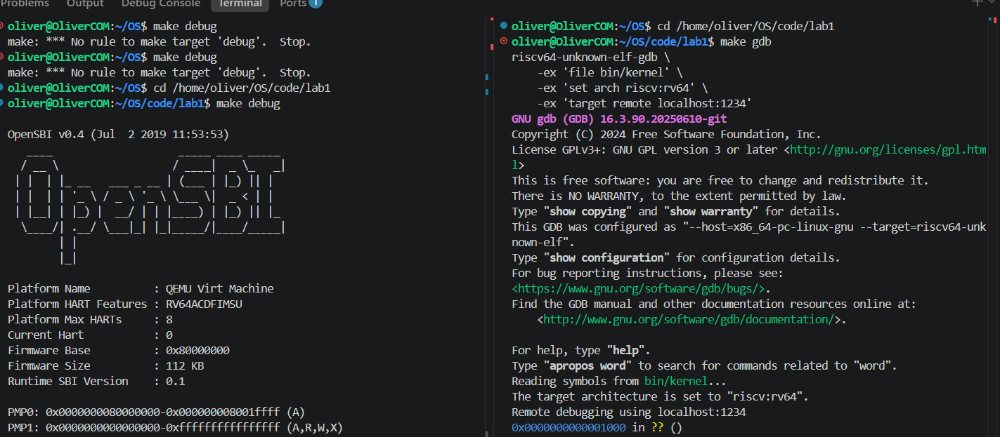
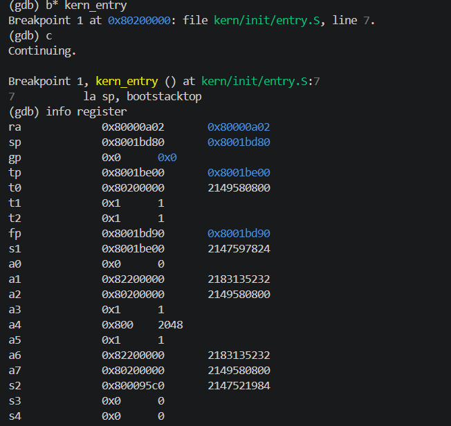
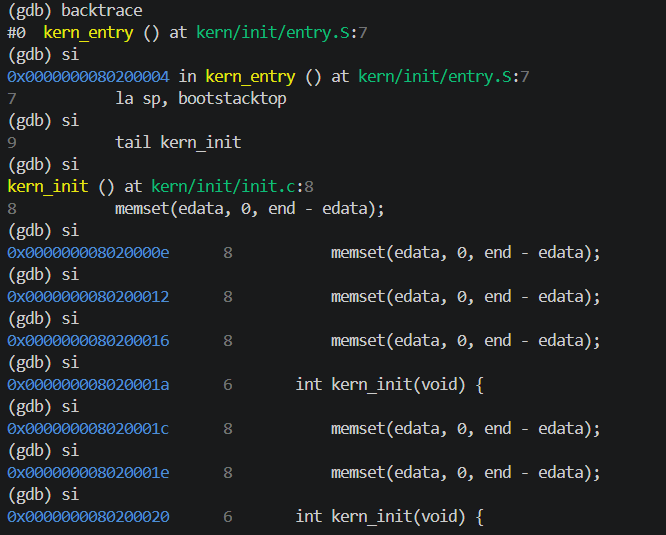
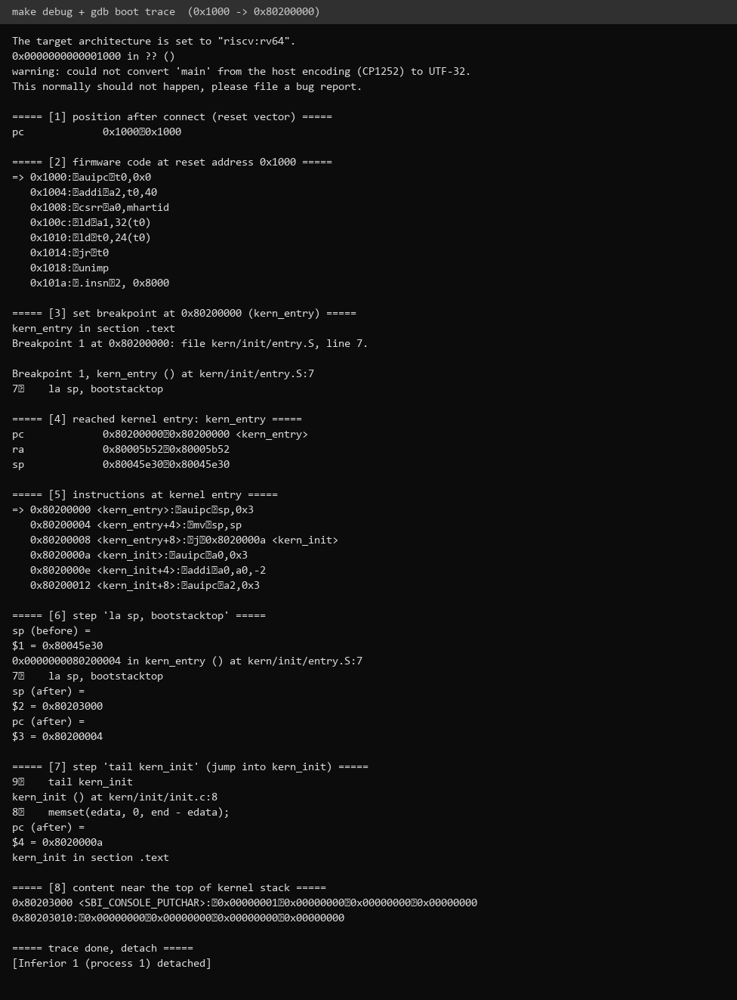
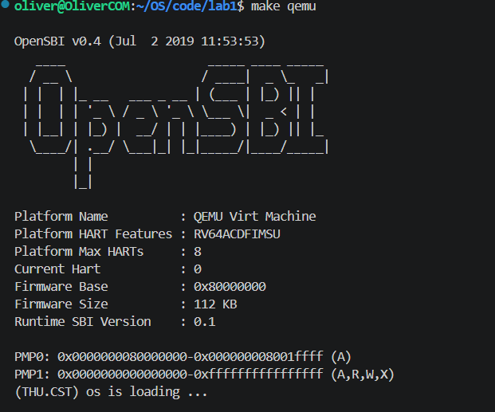
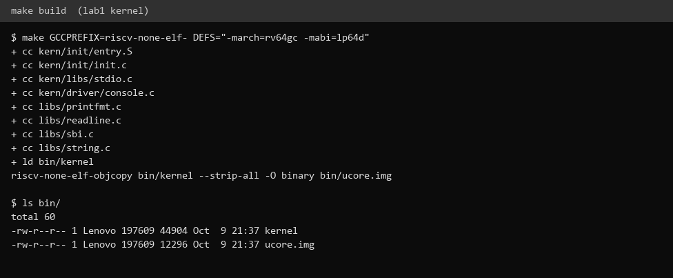
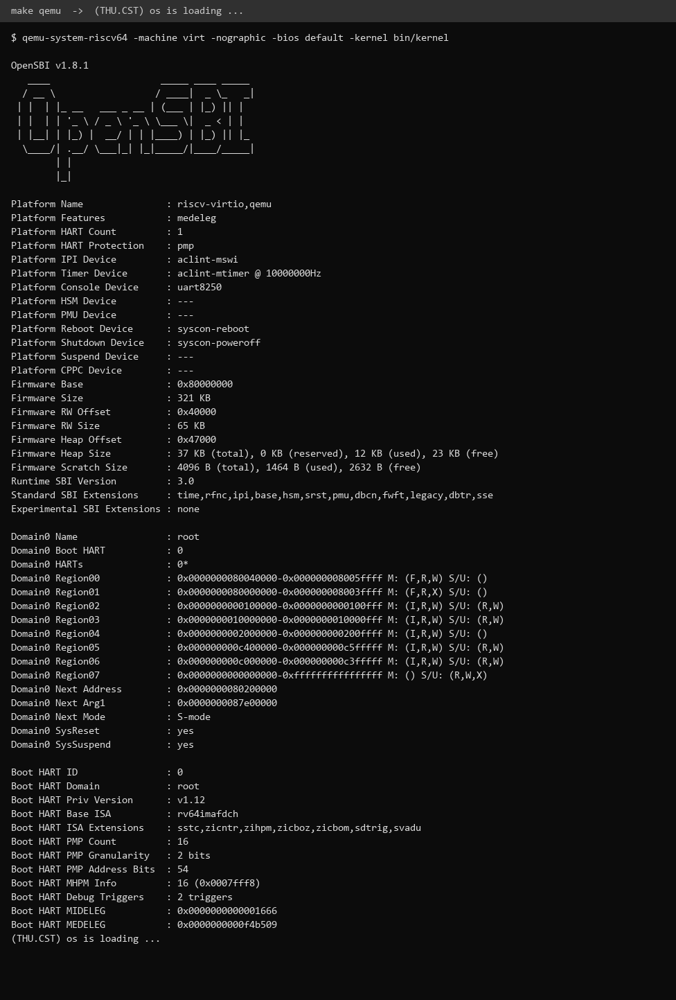

# 操作系统实验报告

## 实验基本信息

| 项目 | 内容 |
|------|------|
| **实验名称** | Lab 1：最小可执行内核（比麻雀更小的麻雀） |
| **小组成员** | 2410550-杨博、2411210-王禹博、2413124-梁昊 |
| **完成日期** | 2026-10-09 |

### 小组分工

| 成员 | 负责的练习/模块 |
|------|----------------|
| 2410550-杨博 | 待填写 |
| 2411210-王禹博 | 待填写 |
| 2413124-梁昊 | 环境适配与 GDB 调试验证 |

实验报告分工：待填写。

---

## 一、实验目的

1. 理解 RISC-V 从复位、运行 OpenSBI 到进入内核的启动流程。
2. 理解内核入口设置栈指针、跳转到 C 初始化函数的作用。
3. 掌握 QEMU 与 GDB 联合调试，使用断点、单步执行和寄存器检查验证启动过程。

---

## 二、实验环境

| 项目 | 内容 |
|------|------|
| 开发环境 | Linux（WSL2），终端运行 Make、QEMU 和 GDB |
| 实验代码 | `code/lab1`，当前分支为 `lab1` |
| 目标平台 | QEMU 4.1.1 的 `virt` 机器，RISC-V 64 位 |
| 编译工具链 | `riscv64-unknown-elf-gcc` 15.1.0、GNU Binutils |
| 调试工具 | `riscv64-unknown-elf-gdb` |
| 启动固件 | OpenSBI v0.4，使用 `-bios default` 加载 |
| 内核加载地址 | `0x80200000` |

### Windows 环境补充

另一组验证在 Windows 原生环境完成，使用 xPack `riscv-none-elf-gcc` 15.2.0、GDB 16.3、GNU Make 4.4.1、QEMU 11.1.0 和 OpenSBI v1.8.1。均在 `code/lab1` 中执行命令：

```bash
make GCCPREFIX=riscv-none-elf- DEFS="-march=rv64gc -mabi=lp64d"
qemu-system-riscv64 -machine virt -nographic -bios default -kernel bin/kernel
```

该工具链需显式指定 RV64 架构和 ABI。此环境下原有 `-device loader` 启动方式未进入内核，改用 `-kernel bin/kernel` 后成功输出启动信息。调试时在 QEMU 命令后追加 `-s -S`，并用 `riscv-none-elf-gdb` 加载 `bin/kernel`、连接 `localhost:1234`。

### AI 工具

| 成员 | AI 编程工具 | 底层模型 | 备注 |
|------|------------|---------|------|
| 2410550-杨博 | 待填写 | 待填写 | |
| 2411210-王禹博 | 待填写 | 待填写 | |
| 2413124-梁昊 | Claude Code（VS Code 扩展） | Claude | |

已记录的实验工具包括 Claude Code（终端 Agent / VS Code 扩展）；各成员对应的工具和模型版本待填写。本报告使用 Codex 辅助整理。

---

## 三、实验整体逻辑分析

### 3.1 本章节的逻辑主线

本实验围绕“CPU 如何进入内核并开始执行 C 代码”展开。启动链路为：

```text
0x1000：复位入口
    → 0x80000000：OpenSBI 初始化
    → 0x80200000：kern_entry 建立内核栈
    → kern_init 清零 BSS、输出启动信息、进入循环
```

### 3.2 功能的逐步实现

1. **加载内核**：链接脚本指定入口为 `kern_entry`、基址为 `0x80200000`；QEMU 将 `bin/ucore.img` 加载到该地址。
2. **建立启动栈**：进入 `kern_entry` 后设置 `sp`，为 C 函数的栈帧和后续函数调用提供空间。
3. **执行内核初始化**：跳转到 `kern_init`，清零 BSS，通过 SBI 输出启动信息，随后停留在无限循环中。
4. **调试验证**：从复位入口开始单步执行，在内核入口设置断点，核对控制流和寄存器变化。

---

## 四、实验内容与实现

### 练习1：理解内核启动中的程序入口操作

**负责人：** [学号-姓名]

`kern/init/entry.S` 中的入口代码为：

```asm
kern_entry:
    la sp, bootstacktop
    tail kern_init
```

**1. `la sp, bootstacktop` 完成了什么操作，目的是什么？**

`la` 是加载地址的伪指令，将 `bootstacktop` 的地址写入栈指针 `sp`，而不是读取该地址处的数据。

`bootstack` 位于 `.data` 段，按 4 KiB 对齐，预留 `KSTACKSIZE = 2 × 4096 = 8192` 字节；`bootstacktop` 位于这段空间的末尾。栈向低地址增长，因此应将 `sp` 设置为栈顶。

其目的是在运行 C 代码前建立内核自己的栈，用于保存返回地址、寄存器和局部变量。断点处原来的 `sp = 0x8001bd80` 属于固件栈；执行该伪指令后，`sp = 0x80203000`，对应内核栈顶。

**2. `tail kern_init` 完成了什么操作，目的是什么？**

`tail` 是尾调用伪指令，将控制流转移到 `kern_init`，不向 `ra` 写入新的返回地址。本次构建中它被链接为 `j 0x8020000a`。

其目的是从汇编入口进入 C 语言初始化流程。`kern_init` 声明为 `noreturn`，清零 `[edata, end)` 范围的 BSS、输出 `(THU.CST) os is loading ...` 后进入无限循环，因此无需返回汇编入口。

### 练习2：使用 GDB 验证启动流程

**负责人：** [学号-姓名]

#### 调试过程

两个终端均进入 `code/lab1`。终端 A 执行：

```bash
make debug
```

该目标用 `-s -S` 启动 QEMU：`-s` 在 TCP 1234 端口开放调试接口，`-S` 让 CPU 暂停，等待调试器连接。终端 B 执行：

```bash
make gdb
```

GDB 加载 `bin/kernel` 的符号并连接 `localhost:1234`，此时 PC 为 `0x1000`。使用以下命令检查并跟踪启动过程：

```gdb
x/5i 0x1000
x/12wx 0x1000
b *kern_entry
si
info registers pc a0 a1 t0
# 重复 si 和寄存器检查，直到 PC 到达 0x80000000
continue
info registers pc sp a0 a1
si
# 继续单步，观察栈初始化及进入 kern_init 的过程
```

截图中最初在仓库根目录执行 `make debug`，出现 `No rule to make target 'debug'`。切换到 `code/lab1` 后即可启动调试。



#### 观察结果与问题解答

**1. RISC-V 加电后最初执行的几条指令位于什么地址？**

本实验使用的 QEMU `virt` 平台从 `0x1000` 的 MROM 复位入口开始执行，前五条指令位于 `0x1000`～`0x1010`。这是该模拟平台的启动配置，不代表所有 RISC-V 硬件都使用同一复位地址。

**2. 这些指令主要完成哪些功能？**

| 地址 | 指令 | 功能 |
|------|------|------|
| `0x1000` | `auipc t0,0x0` | 取得当前代码基址，令 `t0 = 0x1000` |
| `0x1004` | `addi a1,t0,32` | 令 `a1 = 0x1020`，传递设备树 DTB 的地址 |
| `0x1008` | `csrr a0,mhartid` | 将 hart ID 写入 `a0`，本次为 `0` |
| `0x100c` | `ld t0,24(t0)` | 从 `0x1018` 读取固件入口，令 `t0 = 0x80000000` |
| `0x1010` | `jr t0` | 跳转到 `0x80000000`，进入 OpenSBI |

这段代码准备启动参数并将控制权交给固件。单步执行五条指令后，`pc = 0x80000000`、`a0 = 0`、`a1 = 0x1020`。

OpenSBI 完成机器模式（M 模式）初始化，再将控制权交给运行在监督模式（S 模式）的内核。执行 `continue` 后，断点命中 `kern_entry`，地址为 `0x80200000`，对应源代码中的 `la sp, bootstacktop`。此时 `a0 = 0`、`a1 = 0x82200000`，后者是固件重定位后的 DTB 地址；`sp` 仍为 `0x8001bd80`。



继续执行 `si`，先完成栈指针设置，再跳转到 `kern_init`。`la` 是伪指令，本次展开为两条机器指令，因此需要两次单步才能执行完。



#### 新版环境的调试差异

Windows 环境的复位入口同样为 `0x1000`，但该版本的复位代码包含六条指令，寄存器传参方式与上面的旧版环境不同。进入内核前的 `sp = 0x80045e30`；设置内核栈后仍为 `0x80203000`，随后进入 `0x8020000a` 的 `kern_init`。固件栈地址和复位指令序列随版本变化，内核入口与栈顶地址由本实验代码确定。



### 实验提示词

两道练习的提示词见 [prompt.md](./prompt.md)。本实验以源码分析和启动调试为主，没有需要补全的函数。

---

## 五、测试与验证

| 验证项 | 结果 |
|--------|------|
| 复位入口 | GDB 连接后 PC 为 `0x1000`，可反汇编并单步执行启动指令 |
| 固件入口 | 执行 `jr t0` 后 PC 为 `0x80000000` |
| 内核入口 | 断点命中 `0x80200000` 的 `kern_entry` |
| 内核栈 | 执行 `la sp, bootstacktop` 后，`sp = 0x80203000` |
| C 初始化 | 单步执行 `tail kern_init` 后进入 `kern_init` |
| 运行输出 | `make qemu` 输出 `(THU.CST) os is loading ...` |

在 `code/lab1` 中执行 `make qemu`，串口先输出 OpenSBI 信息，随后输出内核启动信息，说明内核已成功运行。之后无进一步输出，与 `kern_init` 末尾的无限循环一致。



Windows 环境也完成了编译和运行验证：





**自动评分说明：** Makefile 定义了 `make grade`，但当前实验目录缺少其依赖的 `tools/grade.sh`，因此未执行自动评分，也无评分通过截图。本次验证依据为 QEMU 运行输出与 GDB 调试结果。

---

## 六、实验总结与收获

### 对操作系统的理解

| 实验知识点 | 对应的 OS 原理及关系 |
|------------|---------------------|
| 复位入口 → OpenSBI → 内核 | 对应系统引导过程。本实验由 ROM 和固件完成前期引导，内核从固定入口接管执行 |
| 设置 `sp` 后进入 C 函数 | 对应运行时环境与栈管理。本实验只建立启动栈，尚未涉及每个进程的内核栈和上下文切换 |
| 清零 BSS | 对应程序装载与内存布局。链接脚本确定区间，内核保证未显式初始化的静态存储对象初始为零 |
| 通过 SBI 输出字符 | 对应特权级和软硬件接口。内核通过 `ecall` 请求固件服务，与用户程序向内核发起系统调用的服务层次不同 |

本实验尚未涉及进程调度、虚拟内存与页表、缺页处理、同步互斥和文件系统。这些内容需要在后续实验中实现。

### AI 协作开发的经验

1. 提供实际代码、链接地址和调试输出，比只描述现象更容易得到准确解释。
2. AI 给出的指令解释应与反汇编、寄存器变化核对，尤其要区分伪指令与机器指令。
3. 报告中的运行结果应以截图和实际验证为准，不将未执行的评分或测试写成通过。
