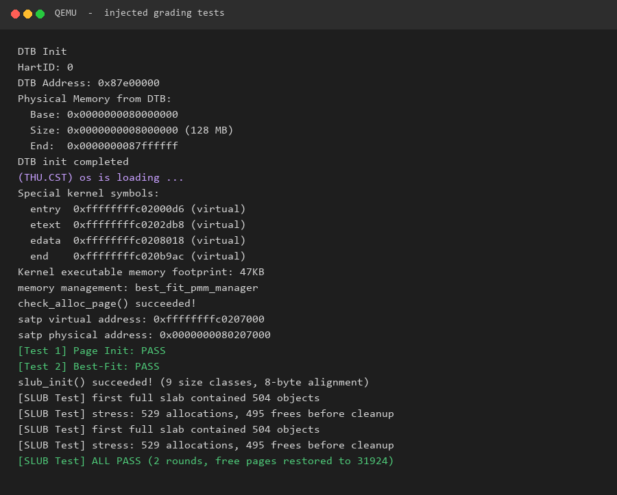

# 操作系统实验报告

## 实验基本信息

| 项目 | 内容 |
|------|------|
| **实验名称** | Lab 4: 进程管理 |
| **小组成员** | 2410550杨博 2411210王禹博 2413124梁昊 |
| **完成日期** | 2026-11-17 |

### 小组分工

练习如何分工？

| 成员 | 负责的练习/模块 |
|------|----------------|
| 2411210-王禹博 | 功能模块一：虚拟内存页操作功能 |
| 学号2-姓名2 | [练习或模块名称] |
| 学号3-姓名3 | [练习或模块名称] |

实验报告如何分工？

---

## 一、实验目的

<!-- 说明本次实验的主要目标和预期成果 -->

本实验的主要目的是：

1. [目的1：例如，理解用户态进程如何通过系统调用进入内核]
2. [目的2：例如，掌握进程创建、执行、退出的完整生命周期]
3. [目的3：例如，学习使用 AI 辅助开发操作系统核心功能]

---

## 二、实验环境

你们使用的 AI 工具

| 成员 | AI 编程工具 | 底层模型 | 备注 |
|------|------------|---------|------|
| 2411210-王禹博 | codex | gpt-6 |
| 学号2-姓名2 | | |
| 学号3-姓名3 | | |

**说明：**
- **AI 编程工具**：指具体使用的终端工具、编辑器插件、桌面应用或浏览器界面
- **底层模型**：指该工具使用的大语言模型及版本

---

## 三、实验整体逻辑分析

### 2.1 本章节的逻辑主线

[请用自己的话描述本章实验的核心主线，例如：
- 本章围绕哪个核心主题展开？（例如：用户进程管理、虚拟内存、文件系统等）
- 整个实验解决什么问题？（例如：如何让用户程序运行在操作系统之上）]

### 2.2 功能的逐步实现

[说明本章实验是按照什么顺序逐步实现各个功能的，以及为什么要按这个顺序，例如：

1. 首先实现**功能A** → 为什么首先实现这个？（例如：建立系统调用接口是后续所有用户态功能的基础）
2. 接着再完善**功能B** → 为什么接着实现这个？（例如：有了系统调用后，需要能够加载和启动第一个用户进程）
3. 然后完成**功能C** → 为什么然后实现这个？（例如：有了第一个进程后，需要实现进程复制功能）
4. 最后补充了**功能D** → 为什么最后实现这个？（例如：最后完善进程退出和清理机制，形成完整闭环）]

---

## 四、实验内容与实现

<!-- 
说明：本部分按照 exercises 文档中的练习顺序组织
每个功能模块或者练习中可能包含多项任务，请根据实际情况调整
-->

## 四、实验内容与实现

### 功能模块一：虚拟内存页操作

**负责人：** 2411210-王禹博

#### 模块功能描述

**需要实现的函数：**

```c
int page_insert(pde_t *pgdir, struct Page *page,
                uintptr_t la, uint32_t perm);

void page_remove(pde_t *pgdir, uintptr_t la);
```

**功能说明：**

本模块在已有多级页表机制的基础上，实现物理页与线性地址之间映射的建立、更新和撤销。

- `page_insert` 建立或更新映射，并维护物理页的引用计数。
- `page_remove` 撤销已有映射；如果映射不存在，则直接返回。
- 页表项发生变化后，使对应的 TLB 项失效。
- 两个接口为后续地址空间管理提供基础。

实现中还使用了模块内部的 `page_remove_pte` 辅助函数，集中处理页表项清除、TLB 失效、引用计数减少及物理页释放。

#### 最终提示词

````markdown
[PROMPT]

**任务**：修改 `kern/mm/pmm.c` 中模块一对应的位置，实现虚拟内存页的映射建立、更新和撤销。

**操作要求**：

1. 必须修改项目中的实际文件，保留现有框架和其他实验模块。
2. 根据已有接口实现 `page_insert` 和 `page_remove`；可增加模块内部使用的 `static` 辅助函数。
3. 不改变公开函数签名，不实现进程创建和调度模块。
4. 可以添加简短注释，说明引用计数、失败处理和 TLB 更新等关键逻辑。

**输出要求**：以项目中的真实定义为准，完成代码修改并进行适当验证；说明实际测试结果和未完成的测试。

[RELY]

可使用项目中已有的定义和接口：

- 页表及物理页类型：`pde_t`、`pte_t`、`struct Page`。
- 页表项定位：`get_pte(pgdir, la, create)`。
- 页表项和物理页转换：`pte_create()`、`pte2page()`、`pde2page()`、`page2ppn()`。
- 引用计数：`page_ref_inc()`、`page_ref_dec()`、`set_page_ref()`。
- 物理页释放：`free_page()`。
- TLB 失效：`tlb_invalidate()`。
- 页表权限和状态位：`PTE_V`、`PTE_R`、`PTE_W`、`PTE_X`、`PTE_U`。
- 内存不足错误码：`E_NO_MEM`。

已有 `get_pte()` 在创建多级页表时可能先分配第一级中间页表，再因后续分配失败而返回空指针。实现映射失败路径时需要考虑这一点。

[GUARANTEE]

必须实现以下接口：

```c
int page_insert(pde_t *pgdir, struct Page *page,
                uintptr_t la, uint32_t perm);

void page_remove(pde_t *pgdir, uintptr_t la);
```

可以添加只在 `pmm.c` 内使用的 `static` 辅助函数，不改变公开接口。

[SPECIFICATION]

## page_insert

**Pre-Condition**：

- `pgdir` 指向有效的页表根。
- `page` 指向待映射的物理页。
- `la` 为目标线性地址，`perm` 为调用者指定的权限位。

**Post-Condition**：

- 成功时返回 `0`，目标页表项映射到 `page`，权限、引用计数和 TLB 状态保持一致。
- 无法分配所需页表时返回 `-E_NO_MEM`，不留下半完成映射；如果本次操作新建了中间页表但后续分配失败，应回收该页表并恢复原状态。

**Case 1：目标地址尚无映射**

建立映射，目标物理页引用计数增加一次。

**Case 2：目标地址已映射到同一物理页**

更新页表项权限，保持物理页引用计数不变，不能释放该页。

**Case 3：目标地址已映射到其他物理页**

撤销旧映射；旧页引用计数减为零时释放旧页。随后建立新映射，目标物理页引用计数增加一次。

**Requirements**：

- 页表项更新后使对应 TLB 项失效。
- 符合 Sv39 叶页表项的权限要求：叶项应具有读或执行权限，可写页同时具有读权限。
- 避免因重复映射同一页而错误释放物理页。

## page_remove

**Pre-Condition**：

- `pgdir` 指向有效的页表根。
- `la` 为需要撤销映射的线性地址。

**Post-Condition**：

- 有有效映射时，清除页表项并使对应 TLB 项失效；物理页引用计数减少一次，减为零时释放物理页。
- 页表项不存在或映射无效时，直接返回，不修改物理页引用计数。
- 重复删除同一映射应安全。
````

#### 实现迭代过程

##### 第一次迭代

完成映射建立与撤销的实现，并增加内部辅助函数处理旧映射。实现时区分了以下情况：

1. 原地址没有映射：增加目标页引用计数并建立映射。
2. 原地址映射到同一物理页：更新权限，引用计数保持不变。
3. 原地址映射到其他物理页：撤销旧映射，再建立新映射。
4. 创建页表失败：返回 `-E_NO_MEM`，并回收本次已创建的第一级中间页表。
5. 删除不存在的映射：直接返回。

**关键处理：**

- 删除映射时先清除页表项并使 TLB 项失效，再减少引用计数；计数为零时释放物理页。
- 对同一物理页重复映射时，只更新页表项，不改变引用计数。
- 按 Sv39 的叶页表项要求补充必要的读权限，使无读写执行权限的叶项以及只写组合不会形成无效映射。

### 功能模块：[模块名称]

**负责人：** [学号-姓名]

#### 模块功能描述

**需要实现/修改的函数：**

```c
// 列出本模块涉及的所有函数签名
void example_function(void);
int another_function(int arg);
```

**功能说明：**

[简要描述该模块的功能，包括：
- 该模块在整个系统中的作用
- 需要处理的主要场景
- 与其他模块的交互关系]

#### 最终提示词

以下是经过迭代优化后，最终成功实现该功能的提示词：

````markdown

[按照提示词模板，给出具体的提示词]

````

#### 实现迭代过程

本模块的实现经历了 [N] 次迭代，过程如下：

---

##### 第一次迭代

如果设计的prompt生成代码后出现问题：

**遇到的问题：**
- 问题1：问题描述、错误信息和原因分析
- 问题2：问题描述、错误信息和原因分析

**问题解决策略：**
- 针对问题1：[说明如何修改提示词]
- 针对问题2：[说明如何修改提示词]

如果没有问题：

**最终结果：**

经过 [N] 次迭代，该模块最终：
- ✅ 编译通过
- ✅ 所有相关测试通过
- ✅ 功能符合预期

**关键改进点总结（如有）：**
1. [改进点1：例如，在 [RELY] 中补充了完整的系统调用号定义]
2. [改进点2：例如，在 [SPECIFICATION] 中明确了异常处理的边界条件]
3. [改进点3：例如，增加了对用户指针合法性检查的要求]

---

##### 第二次迭代（如有）

[按照和第一次迭代相同的格式]

---

##### 第三次迭代（如有）

[按照和第一次迭代相同的格式]

---

### 练习：[练习标题]

**负责人：** [学号-姓名]

[按照练习的具体要求进行解答]

---

### Challenge：[Challenge标题]

**负责人：** [学号-姓名]

[按照Challenge的具体要求进行解答]

---

## 五、测试与验证

<!-- 根据该实验的具体情况，提供完整的测试运行截图，应包含：
- 编译及运行成功的输出（make qemu），可能有多个
- 测试通过的结果（make grade），只有一个
-->

**测试截图：**



---

## 六、实验总结与收获

### 对操作系统的理解

1. 列出你们认为本实验中重要的知识点，以及与对应的 OS 原理中的知识点，并简要说明二者的含义、关系和差异
2. 列出你们认为 OS 原理中很重要、但在本实验中没有对应上的知识点

### AI 协作开发的经验

[写出你们在与 AI 协作过程中实际收获的经验或者感悟]

---

