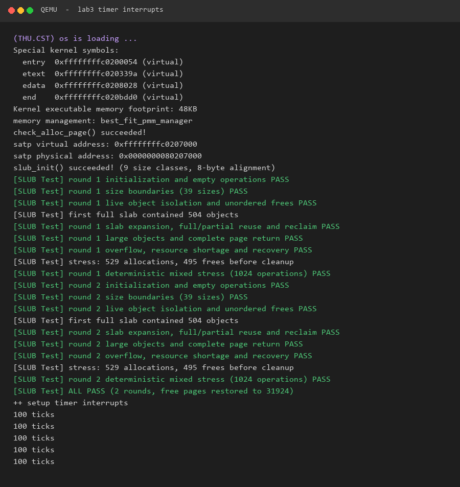
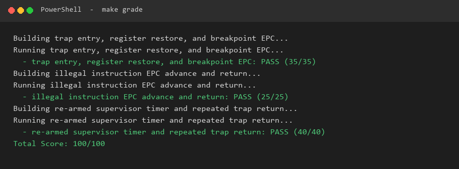

# 操作系统实验报告

## 实验基本信息

| 项目 | 内容 |
|------|------|
| **实验名称** | Lab 3: 中断处理机制 |
| **小组成员** | 2410550-杨博 2411210-王禹博 2413124-梁昊 |
| **完成日期** | 2026.11.3 |

### 小组分工

| 成员 | 负责的练习/模块 |
|------|----------------|
| 2410550-杨博 | 整体报告填写补充 |
| 2411210-王禹博 | 模块一：Trap 上下文恢复与入口 |
| 2413124-梁昊 | 模块二：中断与异常处理；测试与验证 |


---

## 一、实验目的

本实验的主要目的是：

1. 理解 RISC-V 中 Trap 的进入、分类处理和返回过程，以及相关寄存器的作用。
2. 完成 Trap 上下文恢复与汇编入口到 C 处理函数的衔接，保证被打断的执行流能够恢复。
3. 实现时钟中断和指定异常的处理，通过 QEMU 和评分测试验证中断持续触发、异常返回及寄存器恢复。
4. 使用明确的规格与提示词辅助实现，并结合编译和测试结果检查生成代码。

---

## 二、实验环境

### 基本运行环境

| 项目 | 内容 |
|------|------|
| 操作系统 | WSL Ubuntu |
| 目标架构 | RISC-V 64 位 |
| 交叉编译器 | `riscv64-unknown-elf-gcc 15.1.0` |
| 模拟器 | QEMU 4.1.1 |
| 固件 | OpenSBI 0.4 |
| 调试工具 | GNU GDB |
| 模拟物理内存 | 128 MiB |

### AI 工具

| 成员 | AI 编程工具 | 底层模型 | 备注 |
|------|------------|---------|------|
| 2411210-王禹博 | Codex | GPT-6.1 sol | |
| 2410550-杨博 | Codex | GPT-6 | |
| 2413124-梁昊 | Claude Code（VS Code 扩展） | Claude | |

**说明：**
- **AI 编程工具**：指具体使用的终端工具、编辑器插件、桌面应用或浏览器界面
- **底层模型**：指该工具使用的大语言模型及版本

---

## 三、实验整体逻辑分析

### 3.1 本章节的逻辑主线

本章围绕 RISC-V 的 Trap 处理闭环展开：处理器遇到中断或异常时转入内核，内核保存被打断的上下文，根据原因完成处理，再恢复上下文并返回。时钟中断展示了外部事件如何周期性地获得处理；非法指令和断点异常展示了如何记录异常位置并调整返回地址，使程序继续执行。

### 3.2 功能的逐步实现

1. **设置入口与保存现场**：初始化时由 `idt_init()` 将 `stvec` 指向 `__alltraps`；发生 Trap 后，框架的 `SAVE_ALL` 将寄存器和相关 CSR 保存到内核栈上的 Trap frame，为后续 C 代码提供现场。
2. **衔接处理函数和返回路径**：入口将 frame 地址放入 `a0` 并调用 `trap()`；`RESTORE_ALL` 根据同一布局恢复 CSR 和寄存器，最后恢复 `sp`，由 `sret` 返回。先建立这条路径，才能可靠地执行处理逻辑并回到原执行流。
3. **分类处理事件**：`trap_dispatch()` 根据 `cause` 的最高位区分中断和异常。中断处理重设时钟、累计 `ticks` 并按条件关机；异常处理输出信息并按指令长度调整 `epc`，使已处理的异常不会反复触发。
4. **集成验证**：通过断点与非法指令检查现场和返回地址，再通过持续时钟测试检查定时器重装和计数，最终用评分脚本验证整体行为。
---

## 四、实验内容与实现

<!--
说明：本部分按照 exercises 文档中的练习顺序组织
每个功能模块或者练习中可能包含多项任务，请根据实际情况调整
-->

### 功能模块：Trap 上下文恢复与 Trap 入口功能

**负责人：** 2411210-王禹博

#### 模块功能描述

**需要实现/修改的函数：**

本模块需要实现的是汇编宏和入口标签，均位于 `kern/trap/trapentry.S`：

```asm
# 恢复 Trap 上下文的汇编宏
.macro RESTORE_ALL
.endm

# Trap 统一入口
__alltraps:
```

本模块需要对接以下已有 C 函数，保持其签名不变：

```c
void trap(struct trapframe *tf);
```

**功能说明：**

本模块负责 Trap 处理过程中的底层上下文恢复，以及汇编入口与 C 语言处理函数之间的调用衔接，形成以下执行流程：

```text
发生 Trap
→ __alltraps
→ SAVE_ALL 保存上下文
→ trap(tf) 进行 C 语言处理
→ __trapret
→ RESTORE_ALL 恢复上下文
→ sret 返回原执行流
```

框架提供的 `SAVE_ALL` 已将通用寄存器及相关 CSR 保存到当前内核栈上的 Trap frame 中。本模块需要完成以下功能：

1. 在 `__alltraps` 中，将当前 Trap frame 的地址作为参数传递给 `trap()`。
2. 在 `RESTORE_ALL` 中，按照既有保存布局恢复通用寄存器、`sstatus` 和 `sepc`。
3. 在恢复完成后，衔接框架已有的 `sret` 指令，返回被打断的执行流。

本模块需要正确处理 Trap 发生前的栈指针。`SAVE_ALL` 在第 2 槽保存的是分配 Trap frame 之前的原始 `sp`，因此必须在其他寄存器恢复完成后，最后恢复 `sp`，避免后续加载使用错误的基址。

模块一负责上下文管理；模块二负责中断分类、时钟处理、异常信息输出及异常返回地址调整。模块一直接恢复 C 语言处理完成后的 `tf->epc`，不自行判断异常指令长度或增加返回地址。

#### 最终提示词

以下提示词根据本次最终实现整理，可用于复现模块一的实现：

````markdown
[PROMPT]

**任务**：
完成 lab3 的“Trap 上下文恢复与 Trap 入口功能”。
目标文件为 kern/trap/trapentry.S，仅补齐 RESTORE_ALL 和
__alltraps 中标有“lab3 function1 YOUR CODE”的位置。

**操作要求**：
保留现有代码和实验标记，不修改 SAVE_ALL、__trapret 的既有返回逻辑、
struct trapframe、trap() 签名及模块二代码。

**输出要求**：
分别给出 RESTORE_ALL 和 __alltraps 的完整实现，
解释寄存器恢复顺序、参数传递和 Trap 返回机制。
验证结果必须区分汇编编译、独立上下文测试和完整 lab3 评分。

[RELY]

- 目标平台为 RV64，REGBYTES 为 8；使用工程提供的 LOAD、STORE 宏。
- SAVE_ALL 已在当前内核栈上建立 Trap frame：
  - 第 0～31 槽依次对应 x0～x31；
  - 第 32 槽为 status，对应 sstatus；
  - 第 33 槽为 epc，对应 sepc；
  - 第 34 槽为 badvaddr；
  - 第 35 槽为 cause。
- 每个槽占 REGBYTES 字节。
- SAVE_ALL 完成后，sp 指向 Trap frame 起始地址。
- 第 2 槽保存的是分配 Trap frame 之前的原始 sp，
  由 SAVE_ALL 经 sscratch 间接取得；此时 sscratch 已清零。
- 框架提供接口：
  void trap(struct trapframe *tf);
- RISC-V 调用约定使用 a0 传递第一个参数，
  C 函数正常返回时应恢复调用前的 sp。
- __trapret 已包含 RESTORE_ALL 和 sret。
- sret 根据 sepc 返回，并依据 sstatus 中的 SPP、SPIE 等字段
  完成特权级和中断使能状态的转换。

[GUARANTEE]

必须补齐：
1. 汇编宏 RESTORE_ALL。
2. 汇编入口 __alltraps 中 SAVE_ALL 之后的 C 函数调用部分。

不新增公开接口、辅助函数、全局变量或其他模块功能。

[SPECIFICATION]

## RESTORE_ALL

**Pre-Condition**：
- sp 指向合法、可读的 Trap frame，其布局与 SAVE_ALL 一致。
- C 语言处理已经完成，frame 中的返回状态可能已被合法修改。
- 当前处于可以执行相关 CSR 操作的 S 模式。

**Post-Condition**：
- x1～x31 恢复为 frame 中对应的值，x0 保持恒为零。
- sstatus 和 sepc 恢复为 frame 中的 status 和 epc。
- sp 恢复为第 2 槽保存的原始值。
- 后续 sret 能根据恢复后的状态返回。

**Requirements**：
- 恢复其他寄存器期间，sp 必须继续指向当前 frame，
  因此最后恢复 x2；恢复后不得重复增加帧大小。
- 用于恢复 CSR 的临时寄存器，随后也必须恢复其原值。
- 不强制改变 SPP，不提前主动开启中断，不自行增加 sepc。
- badvaddr、cause 仅作为现场信息，不要求写回对应 CSR；
  不将原始 sp 写回 sscratch。

## __alltraps

**Pre-Condition**：
- 处理器已进入 Trap 入口，框架的 SAVE_ALL 可以正常执行。

**Post-Condition**：
- SAVE_ALL 建立的 frame 地址作为第一个参数传入 trap()。
- trap() 正常返回后，执行流进入既有 __trapret，
  完成上下文恢复并执行 sret。

**Requirements**：
- 遵循 RISC-V 调用约定，正确设置第一个参数和函数返回地址。
- 调用前后保持 frame 可供 RESTORE_ALL 使用。
- RV64 下 frame 大小为 36×8＝288 字节；
  在入口栈原本满足 16 字节对齐时，调用 C 函数仍保持对齐。
- 不修改 SAVE_ALL，也不实现模块二的异常或中断处理逻辑。
````

#### 实现迭代过程

本模块的代码实现经历了 **1 次迭代**。本次未观察到需要重新生成代码的模块一功能错误。

---

##### 第一次迭代

**实现过程：**

1. **确认 Trap frame 布局。**

   对照 `SAVE_ALL` 和 `struct trapframe`，确认第 0～31 槽保存通用寄存器，第 32～35 槽分别保存 `status`、`epc`、`badvaddr` 和 `cause`。RV64 下每槽占 8 字节，整个 Trap frame 占 288 字节。

2. **实现返回状态恢复。**

   在 `RESTORE_ALL` 中，使用 `t0`、`t1` 临时加载第 32、33 槽，分别写回 `sstatus` 和 `sepc`。随后恢复通用寄存器，使临时寄存器也恢复为原执行流的状态。

3. **实现通用寄存器恢复。**

   按保存偏移恢复 `x1` 和 `x3～x31`。`x0` 恒为零，无需恢复；最后从第 2 槽恢复 `x2(sp)`。恢复原始 `sp` 后不再增加帧大小，避免重复释放栈空间。

4. **建立汇编到 C 函数的调用关系。**

   在 `SAVE_ALL` 后执行：

   ```asm
   mv a0, sp
   jal trap
   ```

   此时 `sp` 指向 Trap frame，因此 `a0` 对应 C 函数参数 `struct trapframe *tf`。`trap()` 返回后，执行流自然进入 `__trapret`，恢复上下文并执行 `sret`。

**验证过程：**

在独立测试副本中编译测试内核，并通过 QEMU 运行框架提供的寄存器上下文测试。

由于验证时模块二尚未实现，测试副本使用临时断点处理函数推进异常返回地址，以便独立检查模块一的保存、调用、恢复和返回流程。

验证内容包括：

- Trap frame 中保存的原始 `sp` 与分配前的栈顶一致。
- Trap frame 地址满足 16 字节对齐要求。
- 本次测试 Trap 来自 S 模式。
- 断点处理返回后，测试覆盖的通用寄存器保持原值。
- `SAVE_ALL` 保持不变，恢复时使用的寄存器偏移与保存布局一致。

实际测试输出：

```text
Breakpoint at 0xffffffffc0202eac
[Test 1] Trap entry and breakpoint return: PASS (35/35)
```

其中断点地址来自该次测试构建，不作为固定验收值。

**最终结果：**

经过 **1 次迭代**，该模块最终：

- ✅ 汇编代码编译通过。
- ✅ 独立测试副本中的寄存器上下文与断点返回测试通过。
- ✅ 保持 `SAVE_ALL`、`struct trapframe` 和 `trap()` 函数签名不变。
- ✅ 模块一的参数传递、上下文恢复和 Trap 返回流程符合预期。

完整 lab3 的异常处理、持续时钟中断和总评分，需要与模块二集成后验证。

**关键设计点总结：**

1. **以实际保存布局为依据。**  
   在 `[RELY]` 中明确各槽位含义，保证恢复偏移与 `SAVE_ALL` 一致。

2. **最后恢复栈指针。**  
   在 `[SPECIFICATION]` 中明确 `sp` 的特殊性，避免提前恢复后继续使用错误的 frame 基址。

3. **正确恢复临时寄存器。**  
   先利用临时寄存器恢复 CSR，再恢复临时寄存器自身，避免破坏被打断程序的状态。

4. **明确模块职责边界。**  
   异常类型判断和返回地址调整由模块二完成，模块一只恢复处理后的 `sepc`。

5. **保留 Trap 返回状态。**  
   不强制修改 `SPP`，也不提前主动开启中断，由 `sret` 根据恢复的状态完成返回。

---

### 功能模块：中断与异常处理功能

**负责人：** 2413124-梁昊

#### 模块功能描述

**需要实现/修改的函数：**

```c
void interrupt_handler(struct trapframe *tf);
void exception_handler(struct trapframe *tf);
```

**功能说明：**

本模块位于 `kern/trap/trap.c`，负责对 `__alltraps` 保存并传给 `trap()` 的 Trap frame 做分类处理。`trap_dispatch()` 根据 cause 最高位分流：最高位为 1 时进入 `interrupt_handler()`，否则进入 `exception_handler()`。

`interrupt_handler()` 处理三类中断：S 模式时钟中断完成下一次时钟事件设置、`ticks` 计数、每 `TICK_NUM` 次输出统计信息，并在累计达到 `SHUTDOWN_AFTER` 次后调用 `sbi_shutdown()`；S 模式软件中断和外部中断分别输出提示；其他原因输出中断号并调用 `print_trapframe(tf)` 辅助调试。

`exception_handler()` 处理非法指令和断点异常：按约定格式输出异常地址，并根据 `tf->epc` 处指令的长度推进返回地址，避免 `sret` 返回后重复执行同一条异常指令；其他异常使用 `print_trapframe(tf)` 兜底。

与模块一的配合关系是：模块一负责 Trap frame 的保存、`trap()` 参数传递和上下文恢复，本模块只修改处理结果（`ticks`、`tf->epc`）并输出信息；本模块返回后，由模块一恢复 `sepc` 并执行 `sret`。

#### 最终提示词

以下是经过迭代优化后，最终成功实现该功能的提示词：

````markdown
[PROMPT]

**任务**：
完成 lab3 的“中断与异常处理功能”。
目标文件为 kern/trap/trap.c，仅补齐 interrupt_handler 和
exception_handler，替换标有“lab3 function2 YOUR CODE”的位置。

**操作要求**：
保留现有代码和实验标记，不修改 trap()、trap_dispatch()、
print_trapframe()、struct trapframe、trapentry.S 及模块一代码。

**输出要求**：
给出两个函数的完整实现，说明 cause 的判断方式、时钟重装、
ticks 统计、关机条件、epc 调整依据；
给出 Test 1/2/3 的验证方法。

[RELY]

- trapframe 见 kern/trap/trap.h：gpr、status、epc、badvaddr、cause。
- scause 最高位（bit 63）为 1 表示中断，其余位为原因编号。
- 宏定义：IRQ_S_SOFT=1、IRQ_S_TIMER=5、IRQ_S_EXT=9、
  CAUSE_ILLEGAL_INSTRUCTION=2、CAUSE_BREAKPOINT=3。
- TICK_NUM=100；ticks 是 clock.h 中的 volatile size_t。
- clock_set_next_event() 用于设置下一次时钟事件；
  print_ticks() 已实现；sbi_shutdown() 在 libs/sbi.h 中。
- 异常返回地址由 tf->epc 决定，返回前由模块一恢复 sepc。
- 指令可能是 32 位或 16 位压缩指令，低两位为 0b11 表示 32 位。
- SHUTDOWN_AFTER 实验框架未定义，需要在 trap.c 中补充。
- 未列出的中断或异常只要求用 print_trapframe(tf) 兜底。

[GUARANTEE]

必须实现：
1. void interrupt_handler(struct trapframe *tf);
2. void exception_handler(struct trapframe *tf);
不修改函数签名，不新增公开接口或其他模块功能。

[SPECIFICATION]

## interrupt_handler

**Pre-Condition**：
- tf 指向合法的 trapframe。
- 通过 trap_dispatch 调用时 cause 最高位为 1；
  测试代码也可能直接传入正数 cause。

**Post-Condition**：
- IRQ_S_TIMER：重装下一次时钟事件，ticks 加一；
  每 TICK_NUM 次输出一次统计；达到 SHUTDOWN_AFTER 次统计后关机。
- IRQ_S_SOFT：输出“Supervisor software interrupt”。
- IRQ_S_EXT：输出“Supervisor external interrupt”。
- 其他：输出“Unknown interrupt: cause N”，并调用 print_trapframe(tf)。

**Requirements**：
- 判断前先用 cause &= ~(1UL << 63) 去掉中断标志位，
  不能只依赖有符号数判断。
- 时钟中断必须重装定时器，否则系统只能收到一次时钟中断。
- ticks 每收到一次时钟中断加一，统计输出不得改变递增规则。
- 关机只在第 SHUTDOWN_AFTER 次统计输出后执行。

## exception_handler

**Pre-Condition**：
- tf 有效，cause 为异常编号，最高位为 0。

**Post-Condition**：
- CAUSE_ILLEGAL_INSTRUCTION：输出“Illegal instruction at 0x...”，
  并把 epc 前进一条指令的长度。
- CAUSE_BREAKPOINT：输出“Breakpoint at 0x...”，
  并把 epc 前进一条指令的长度。
- 其他：调用 print_trapframe(tf)。

**Requirements**：
- 读取 epc 处指令的最低两位：0b11 为 4 字节，否则为 2 字节。
- 不得统一按 4 字节推进，否则遇到压缩指令会跳到错误位置。
- 输出格式必须与实验评测检查的字符串一致。
````

#### 实现迭代过程

本模块的实现经历了 **2 次迭代**，过程如下：

---

##### 第一次迭代

**遇到的问题：**

- 问题1：本机的 `riscv-none-elf-gcc 15.2` 无法识别模块一 `trapentry.S` 中的 `sbadaddr` CSR 名称，整个工程汇编失败，报错为 `Error: unknown CSR sbadaddr`。
- 问题2：最初考虑异常返回统一执行 `epc += 4`；但 RISC-V 支持 16 位压缩指令，如果触发异常的指令只有 2 字节，加 4 会跳过过多字节，导致返回地址错误。

**问题解决策略：**

- 针对问题1：把 `csrr s3, sbadaddr` 改成标准 CSR 名称 `stval`，与 `badvaddr` 的语义一致。这属于工具链兼容性修改，不改变模块一的保存布局。
- 针对问题2：在提示词的 `[SPECIFICATION]` 中明确“读取 `epc` 处指令最低两位判断长度”，实现 `insn_length()`：低两位为 `0b11` 返回 4，否则返回 2。

##### 第二次迭代

**遇到的问题：**

- 问题3：`interrupt_handler()` 既会被 `trap_dispatch()` 以最高位为 1 的 cause 调用，也会被测试代码直接传入正数 cause（例如 `15`）。如果只按有符号数判断，直接调用的情况会被漏掉。

**问题解决策略：**

- 针对问题3：进入函数后先执行 `cause &= ~((uintptr_t)1 << 63)` 去掉中断标志位，再按原因编号分支；遇到未知中断时同时输出 cause 和完整 trapframe，便于定位问题。

**最终结果：**

经过 **2 次迭代**，该模块最终：

- ✅ 编译通过。
- ✅ Test 1（Trap 入口、寄存器恢复与断点返回）：`PASS (35/35)`。
- ✅ Test 2（非法指令返回与兜底处理）：`PASS (25/25)`。
- ✅ Test 3（持续时钟中断）：`PASS (40/40, ticks=200)`。
- ✅ `make grade` 总分 `100/100`。

实际测试输出：

```text
Breakpoint at 0xffffffffc0202ea8
[Test 1] Trap entry and breakpoint return: PASS (35/35)
Illegal instruction at 0xffffffffc0202e5a
Supervisor software interrupt
Unknown interrupt: cause 15
  cause    0x00000014
[Test 2] Illegal instruction return: PASS (25/25)
100 ticks
100 ticks
[Test 3] Sustained supervisor timer: PASS (40/40, ticks=200)
100 ticks
100 ticks
100 ticks
Total Score: 100/100
```

其中断点和非法指令地址来自本机测试构建，不作为固定验收值。

**关键设计点总结：**

1. **先去掉中断标志位再分类。**  
   `scause` 最高位只表示“是否中断”，原因编号在低位；显式屏蔽 bit 63 后，`trap_dispatch()` 调用和测试直接调用可以使用同一套判断。

2. **时钟中断必须重装。**  
   每次进入时钟中断都调用 `clock_set_next_event()`，否则只能收到第一次时钟中断。

3. **计数与输出分离。**  
   `ticks` 每收到一次时钟中断就加一；只在 `ticks % TICK_NUM == 0` 时输出统计，达到 `SHUTDOWN_AFTER` 次统计后关机。

4. **按指令长度推进 epc。**  
   读取 `epc` 处指令的最低两位判断 2 字节或 4 字节，既覆盖 `ebreak`，也覆盖压缩指令场景，避免异常循环。

5. **未知原因统一兜底。**  
   未列出的中断和异常调用 `print_trapframe(tf)` 输出完整现场，便于后续扩展和调试。

---

## 五、测试与验证

<!-- 根据该实验的具体情况，提供完整的测试运行截图，应包含：
- 编译及运行成功的输出（make qemu），可能有多个
- 测试通过的结果（make grade），只有一个
-->

**测试截图：**





---

## 六、实验总结与收获

### 对操作系统的理解

| 实验中的知识点 | 对应的 OS 原理及关系、差异 |
|------|------|
| Trap 入口与现场恢复 | 中断或异常使处理器进入内核，处理完成后恢复现场，体现了操作系统对执行流的接管。实验以 RISC-V 的 `stvec`、`sepc`、`sstatus` 和 `sret` 实现；通用原理不依赖某一种指令集。 |
| Trap frame | 将通用寄存器和相关状态保存在栈上，使处理函数可查看或修改返回现场。它与上下文切换都需要保存执行状态，但本实验的路径主要返回原执行流，并未实现进程调度切换。 |
| 中断和异常分类 | 中断由计时器等事件触发，异常与当前指令执行相关；两者都通过 Trap 进入内核，但原因与返回策略不同。实验通过 `scause` 的最高位分流，并按原因编号处理。 |
| 时钟中断 | 周期性时钟是操作系统计时和抢占调度的基础。实验每次重设时钟并累计 `ticks`，用于统计和关机；它本身没有实现时间片调度。 |
| 异常返回地址 | 返回地址决定恢复后执行的位置。实验对断点和非法指令按 2 或 4 字节推进 `epc`；实际操作系统还需按异常语义决定重试、终止或交给其他处理机制，不能一律跳过。 |

OS 原理中还有一些重要知识点没有在本实验中实现对应机制：进程和线程调度及上下文切换、用户态与内核态之间的系统调用、虚拟内存与缺页处理，以及并发访问共享数据时的同步和互斥。这些机制可以使用 Trap 或时钟作为入口或基础，但本实验的处理路径和测试并未覆盖它们的完整实现。

### AI 协作开发的经验

将已有代码布局、调用约定和模块边界写入提示词，可以减少生成代码与框架不匹配的问题。规格中明确前置条件、返回状态和约束，例如最后恢复 `sp`、异常按指令长度调整 `epc`，也便于逐项检查结果。生成代码仍需对照实际工具链和测试验证：本次遇到 CSR 名称兼容问题，并在设计中修正了统一按 4 字节推进返回地址的风险。独立测试能定位模块问题，集成测试则验证两个模块共同工作的结果；测试通过的范围应与实际测试内容一致。

---
