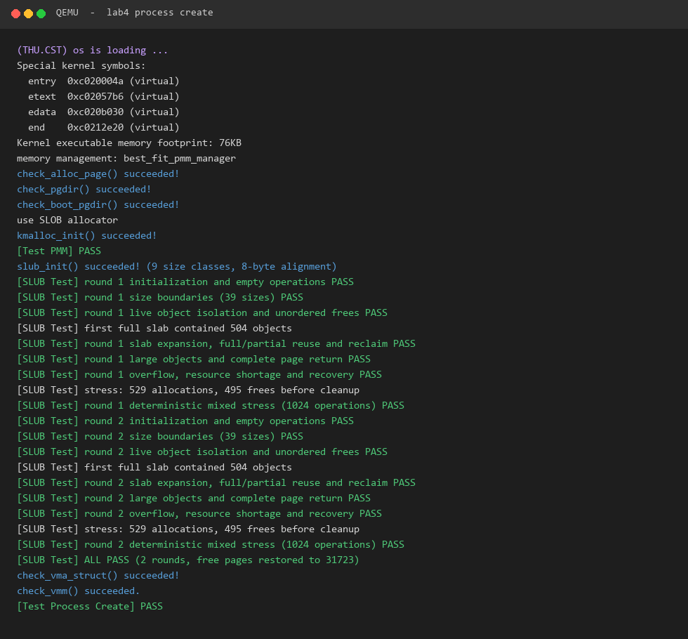
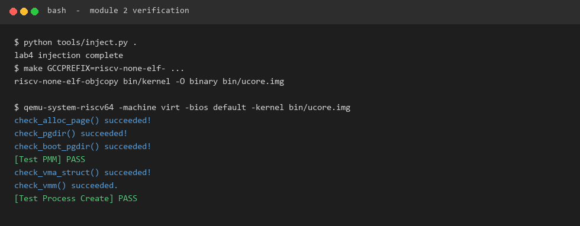

# 操作系统实验报告

## 实验基本信息

| 项目 | 内容 |
|------|------|
| **实验名称** | Lab 4: 进程管理 |
| **小组成员** | 2410550杨博 2411210王禹博 2413124梁昊 |
| **完成日期** | 2026-11-17 |

### 小组分工

练习如何分工？

| 成员 | 负责的练习/模块 |
|------|----------------|
| 2411210-王禹博 | 功能模块一：虚拟内存页操作功能 |
| 2413124-梁昊 | 功能模块二：进程创建及初始化功能；测试与验证 |
| 学号3-姓名3 | [练习或模块名称] |

实验报告如何分工？

---

## 一、实验目的

<!-- 说明本次实验的主要目标和预期成果 -->

本实验的主要目的是：

1. [目的1：例如，理解用户态进程如何通过系统调用进入内核]
2. [目的2：例如，掌握进程创建、执行、退出的完整生命周期]
3. [目的3：例如，学习使用 AI 辅助开发操作系统核心功能]

---

## 二、实验环境

你们使用的 AI 工具

| 成员 | AI 编程工具 | 底层模型 | 备注 |
|------|------------|---------|------|
| 2411210-王禹博 | codex | gpt-6 |
| 2413124-梁昊 | Claude Code（VS Code 扩展） | Claude |
| 学号3-姓名3 | | |

**说明：**
- **AI 编程工具**：指具体使用的终端工具、编辑器插件、桌面应用或浏览器界面
- **底层模型**：指该工具使用的大语言模型及版本

---

## 三、实验整体逻辑分析

### 2.1 本章节的逻辑主线

[请用自己的话描述本章实验的核心主线，例如：
- 本章围绕哪个核心主题展开？（例如：用户进程管理、虚拟内存、文件系统等）
- 整个实验解决什么问题？（例如：如何让用户程序运行在操作系统之上）]

### 2.2 功能的逐步实现

[说明本章实验是按照什么顺序逐步实现各个功能的，以及为什么要按这个顺序，例如：

1. 首先实现**功能A** → 为什么首先实现这个？（例如：建立系统调用接口是后续所有用户态功能的基础）
2. 接着再完善**功能B** → 为什么接着实现这个？（例如：有了系统调用后，需要能够加载和启动第一个用户进程）
3. 然后完成**功能C** → 为什么然后实现这个？（例如：有了第一个进程后，需要实现进程复制功能）
4. 最后补充了**功能D** → 为什么最后实现这个？（例如：最后完善进程退出和清理机制，形成完整闭环）]

---

## 四、实验内容与实现

<!-- 
说明：本部分按照 exercises 文档中的练习顺序组织
每个功能模块或者练习中可能包含多项任务，请根据实际情况调整
-->

## 四、实验内容与实现

### 功能模块一：虚拟内存页操作

**负责人：** 2411210-王禹博

#### 模块功能描述

**需要实现的函数：**

```c
int page_insert(pde_t *pgdir, struct Page *page,
                uintptr_t la, uint32_t perm);

void page_remove(pde_t *pgdir, uintptr_t la);
```

**功能说明：**

本模块在已有多级页表机制的基础上，实现物理页与线性地址之间映射的建立、更新和撤销。

- `page_insert` 建立或更新映射，并维护物理页的引用计数。
- `page_remove` 撤销已有映射；如果映射不存在，则直接返回。
- 页表项发生变化后，使对应的 TLB 项失效。
- 两个接口为后续地址空间管理提供基础。

实现中还使用了模块内部的 `page_remove_pte` 辅助函数，集中处理页表项清除、TLB 失效、引用计数减少及物理页释放。

#### 最终提示词

````markdown
[PROMPT]

**任务**：修改 `kern/mm/pmm.c` 中模块一对应的位置，实现虚拟内存页的映射建立、更新和撤销。

**操作要求**：

1. 必须修改项目中的实际文件，保留现有框架和其他实验模块。
2. 根据已有接口实现 `page_insert` 和 `page_remove`；可增加模块内部使用的 `static` 辅助函数。
3. 不改变公开函数签名，不实现进程创建和调度模块。
4. 可以添加简短注释，说明引用计数、失败处理和 TLB 更新等关键逻辑。

**输出要求**：以项目中的真实定义为准，完成代码修改并进行适当验证；说明实际测试结果和未完成的测试。

[RELY]

可使用项目中已有的定义和接口：

- 页表及物理页类型：`pde_t`、`pte_t`、`struct Page`。
- 页表项定位：`get_pte(pgdir, la, create)`。
- 页表项和物理页转换：`pte_create()`、`pte2page()`、`pde2page()`、`page2ppn()`。
- 引用计数：`page_ref_inc()`、`page_ref_dec()`、`set_page_ref()`。
- 物理页释放：`free_page()`。
- TLB 失效：`tlb_invalidate()`。
- 页表权限和状态位：`PTE_V`、`PTE_R`、`PTE_W`、`PTE_X`、`PTE_U`。
- 内存不足错误码：`E_NO_MEM`。

已有 `get_pte()` 在创建多级页表时可能先分配第一级中间页表，再因后续分配失败而返回空指针。实现映射失败路径时需要考虑这一点。

[GUARANTEE]

必须实现以下接口：

```c
int page_insert(pde_t *pgdir, struct Page *page,
                uintptr_t la, uint32_t perm);

void page_remove(pde_t *pgdir, uintptr_t la);
```

可以添加只在 `pmm.c` 内使用的 `static` 辅助函数，不改变公开接口。

[SPECIFICATION]

## page_insert

**Pre-Condition**：

- `pgdir` 指向有效的页表根。
- `page` 指向待映射的物理页。
- `la` 为目标线性地址，`perm` 为调用者指定的权限位。

**Post-Condition**：

- 成功时返回 `0`，目标页表项映射到 `page`，权限、引用计数和 TLB 状态保持一致。
- 无法分配所需页表时返回 `-E_NO_MEM`，不留下半完成映射；如果本次操作新建了中间页表但后续分配失败，应回收该页表并恢复原状态。

**Case 1：目标地址尚无映射**

建立映射，目标物理页引用计数增加一次。

**Case 2：目标地址已映射到同一物理页**

更新页表项权限，保持物理页引用计数不变，不能释放该页。

**Case 3：目标地址已映射到其他物理页**

撤销旧映射；旧页引用计数减为零时释放旧页。随后建立新映射，目标物理页引用计数增加一次。

**Requirements**：

- 页表项更新后使对应 TLB 项失效。
- 符合 Sv39 叶页表项的权限要求：叶项应具有读或执行权限，可写页同时具有读权限。
- 避免因重复映射同一页而错误释放物理页。

## page_remove

**Pre-Condition**：

- `pgdir` 指向有效的页表根。
- `la` 为需要撤销映射的线性地址。

**Post-Condition**：

- 有有效映射时，清除页表项并使对应 TLB 项失效；物理页引用计数减少一次，减为零时释放物理页。
- 页表项不存在或映射无效时，直接返回，不修改物理页引用计数。
- 重复删除同一映射应安全。
````

#### 实现迭代过程

##### 第一次迭代

完成映射建立与撤销的实现，并增加内部辅助函数处理旧映射。实现时区分了以下情况：

1. 原地址没有映射：增加目标页引用计数并建立映射。
2. 原地址映射到同一物理页：更新权限，引用计数保持不变。
3. 原地址映射到其他物理页：撤销旧映射，再建立新映射。
4. 创建页表失败：返回 `-E_NO_MEM`，并回收本次已创建的第一级中间页表。
5. 删除不存在的映射：直接返回。

**关键处理：**

- 删除映射时先清除页表项并使 TLB 项失效，再减少引用计数；计数为零时释放物理页。
- 对同一物理页重复映射时，只更新页表项，不改变引用计数。
- 按 Sv39 的叶页表项要求补充必要的读权限，使无读写执行权限的叶项以及只写组合不会形成无效映射。

### 功能模块二：进程创建及初始化功能

**负责人：** 2413124-梁昊

#### 模块功能描述

**需要实现/修改的函数：**

```c
static struct proc_struct *alloc_proc(void);                          // kern/process/proc.c
void proc_init(void);                                                 // kern/process/proc.c
int kernel_thread(int (*fn)(void *), void *arg, uint32_t clone_flags); // kern/process/proc.c
int do_fork(uint32_t clone_flags, uintptr_t stack, struct trapframe *tf); // kern/process/proc.c
static void copy_thread(struct proc_struct *proc, uintptr_t esp, struct trapframe *tf); // kern/process/proc.c
static int copy_mm(uint32_t clone_flags, struct proc_struct *proc);   // kern/process/proc.c
```

**功能说明：**

本模块把内核从"只能运行一段初始化代码"推进到"能够创建、登记多个内核线程"。

- `alloc_proc` 从堆上分配一个进程控制块，并把所有字段置成安全的初值。PCB 里的指针和状态如果没有显式初始化，后面的代码就可能读到随机值。
- `proc_init` 建立全局进程链表和 PID 哈希表，然后把当前这段执行现场直接登记成 `idleproc`，再通过 `kernel_thread` 创建第一个真正的内核线程 `initproc`。
- `kernel_thread` 只负责构造一个临时的 trapframe：把线程入口函数和参数分别放进 `s0`、`s1`，把 `epc` 指向 `kernel_thread_entry`，然后交给 `do_fork`。
- `do_fork` 负责把 PCB、内核栈、PID、链表挂接、就绪状态组合成一个可运行的线程，并处理失败时的资源回收。
- `copy_thread` 把 trapframe 和 `context` 放到新线程自己的内核栈上，使它在第一次被调度时能经 `forkret -> forkrets -> __trapret` 正确进入入口函数。
- `copy_mm` 在本实验中只是占位：当前创建的是内核线程，`current->mm` 本来就是 `NULL`，不需要复制用户地址空间。

#### 最终提示词

以下是经过迭代优化后，最终成功实现该功能的提示词：

````markdown
[PROMPT]

**任务**：修改 `kern/process/proc.c` 中"功能模块二"对应的位置，实现进程创建及初始化功能，包括 `alloc_proc`、`proc_init`、`kernel_thread`、`do_fork`、`copy_thread` 和 `copy_mm`。

**操作要求**：

1. 必须在项目中修改实际文件，保留现有框架代码、`forkret`、`setup_kstack`、`put_kstack` 等已有函数，以及模块一和模块三的标记位置。
2. 只在 `//LAB4 function2` 标记处补全代码，不修改 `proc.h`、`trap.c`、`pmm.c` 等共享文件。
3. 不实现进程调度（`schedule`、`proc_run`、`cpu_idle`、`switch_to`）。
4. 允许添加模块内部使用的 `static` 函数和局部辅助逻辑。

**输出要求**：直接进行文件操作，以工程中的真实定义为准；完成后说明首次运行链路和失败清理路径。

[RELY]

// 数据结构与全局变量
struct proc_struct { state, pid, runs, kstack, need_resched, parent, mm,
                     context, tf, pgdir, flags, name, list_link, hash_link };
struct context { ra, sp, s0..s11 };
struct trapframe { gpr.s0, gpr.s1, gpr.a0, gpr.sp, status, epc, ... };
list_entry_t proc_list;  static list_entry_t hash_list[HASH_LIST_SIZE];
struct proc_struct *idleproc, *initproc, *current;  static int nr_process;
#define HASH_SHIFT 10   #define HASH_LIST_SIZE (1 << HASH_SHIFT)
#define MAX_PROCESS 4096  #define PROC_NAME_LEN 15
#define KSTACKPAGE 2      #define KSTACKSIZE (KSTACKPAGE * PGSIZE)

// 可用函数与符号
kmalloc()/kfree()/memset()/memcpy()
alloc_pages()/free_pages()/page2kva()/kva2page()
setup_kstack()/put_kstack()/get_pid()/hash_proc()/find_proc()
set_proc_name()/wakeup_proc()/list_init()/list_add()
boot_pgdir_pa、bootstack
read_csr(sstatus)、SSTATUS_SPP、SSTATUS_SPIE、SSTATUS_SIE
kernel_thread_entry、forkret、forkrets
CLONE_VM、E_NO_MEM、E_NO_FREE_PROC

[GUARANTEE]

必须实现或修改的接口：

```c
static struct proc_struct *alloc_proc(void);
void proc_init(void);
int kernel_thread(int (*fn)(void *), void *arg, uint32_t clone_flags);
int do_fork(uint32_t clone_flags, uintptr_t stack, struct trapframe *tf);
static void copy_thread(struct proc_struct *proc, uintptr_t esp, struct trapframe *tf);
static int copy_mm(uint32_t clone_flags, struct proc_struct *proc);
```

[SPECIFICATION]

## alloc_proc

**Pre-Condition**：
- `kmalloc` 可用，系统中还有空闲堆空间。

**Post-Condition**：
- 成功时返回一个所有字段都已显式初始化的 PCB；失败时返回 `NULL`。

**Case 1**：分配成功时，`state=PROC_UNINIT`、`pid=-1`、`runs=0`、`kstack=0`、`need_resched=0`、`parent=NULL`、`mm=NULL`、`tf=NULL`、`flags=0`、`context` 全零、`name` 清零、`pgdir=boot_pgdir_pa`，PCB 尚未挂入任何链表。

**Case 2**：`kmalloc` 返回 `NULL` 时直接返回 `NULL`，不修改任何全局状态。

**Requirements**：
- `context` 必须清零，这样 idleproc 的 `context.ra` 才会是 0，后续调度也不会误用未初始化的返回地址。

## proc_init

**Pre-Condition**：
- `pmm_init`、`vmm_init` 已完成，`bootstack`、`boot_pgdir_pa` 有效。

**Post-Condition**：
- `proc_list` 与 `hash_list` 已初始化；`idleproc` 的 pid 为 0、状态为 `PROC_RUNNABLE`、`kstack` 指向 `bootstack`；`current == idleproc`；`initproc` 存在且 pid 为 1、父进程为 `idleproc`。

**Case 1**：`idleproc` 分配失败时调用 `panic`，因为后续流程没有可运行的执行现场。

**Case 2**：`kernel_thread(init_main, "Hello world!!", 0)` 返回负值或 0 时调用 `panic`；否则用 `find_proc` 找回 PCB，命名为 `init`。

**Requirements**：
- `idleproc` 不是 fork 出来的，不挂入 `proc_list`/`hash_list`，调度器在链表为空时会显式回退到它。

## kernel_thread

**Pre-Condition**：
- `fn` 为合法的内核函数入口，`arg` 为传给它的参数。

**Post-Condition**：
- 新建线程首次运行时执行 `fn(arg)`；函数返回后经 `kernel_thread_entry` 调用 `do_exit`。
- 返回值是新线程的 pid，创建失败时为负错误码。

**Case 1**：正常创建时，`trapframe.gpr.s0` 保存函数地址、`gpr.s1` 保存参数、`epc` 指向 `kernel_thread_entry`、`status` 设置 `SPP/SPIE` 并清除 `SIE`。

**Case 2**：`do_fork` 失败时直接把错误码返回给调用者。

**Requirements**：
- `status` 必须保留 S 态（`SPP=1`）并让 `sret` 之后重新开中断（`SPIE=1`），同时避免返回前被中断打断（`SIE=0`）。

## do_fork

**Pre-Condition**：
- `current` 指向当前线程，`tf` 指向调用者提供的 trapframe 模板。

**Post-Condition**：
- 成功时返回新线程 pid，新 PCB 已挂入 `proc_list` 和 `hash_list`，状态为 `PROC_RUNNABLE`。
- 失败时返回负错误码，且不残留已分配的内核栈或 PCB。

**Case 1**：`nr_process >= MAX_PROCESS` 时返回 `-E_NO_FREE_PROC`。

**Case 2**：`alloc_proc` 或 `setup_kstack` 失败时分别返回 `-E_NO_MEM`；已分配的 PCB 用 `kfree` 回收，已分配的内核栈用 `put_kstack` 回收，顺序与分配顺序相反。

**Case 3**：`copy_mm` 失败时回收内核栈和 PCB；成功时依次执行 `copy_thread`、分配 pid、挂链表、`nr_process++`、`wakeup_proc`。

**Requirements**：
- `get_pid + hash_proc + list_add + nr_process++` 必须在关中断的临界区内完成，避免时钟中断看到只挂了一半的链表。

## copy_thread

**Pre-Condition**：
- `proc->kstack` 已指向刚分配的两个连续物理页，`tf` 是模板。

**Post-Condition**：
- `proc->tf` 指向内核栈顶部的 trapframe 副本，`gpr.a0=0`，`gpr.sp` 指向该 trapframe；`context.ra=forkret`，`context.sp=trapframe`。

**Case 1**：`esp == 0`（内核线程）时，新线程使用 trapframe 自身作为初始栈指针。

**Case 2**：`esp != 0`（以后用于用户进程）时，按调用者给出的用户栈地址设置 `gpr.sp`。

## copy_mm

**Pre-Condition**：
- `current` 是内核线程，`current->mm == NULL`。

**Post-Condition**：
- `proc->mm = NULL` 并返回 0；不复制任何用户地址空间。

**Requirements**：
- 当前阶段不做真正的 mm 复制，但函数形态要保留，方便后续实验扩展。
````

#### 实现迭代过程

##### 第一次迭代

**遇到的问题：**

- 生成的 `alloc_proc` 只初始化了状态、pid 和几个指针，没有清零 `context`，也没有设置 `pgdir`。由于 `kmalloc` 返回的内存不保证为零，`idleproc->context.ra` 可能是随机值，测试在 `assert(idleproc->context.ra == 0)` 处失败。
- `proc_init` 把 `idleproc` 当成普通线程挂进了 `proc_list`。调度器遍历链表时会把"当前执行现场"和"空闲回退线程"混在一起，链表为空时找不到 `idleproc`。

**问题解决策略：**

- 在 [SPECIFICATION] 中逐字段列出 `alloc_proc` 的初始化要求，特别写明"`context` 必须清零、`pgdir` 指向内核页表"，并要求把该函数当成"返回干净 PCB"来验收。
- 在 [RELY] 中补充说明 `idleproc` 与普通 fork 线程的区别：直接复用 `bootstack`、不入链表、调度器会显式回退到它。

##### 第二次迭代

**遇到的问题：**

- 第一版 `copy_thread` 把 `context.sp` 设成了内核栈顶，但 `context.ra` 仍然指向函数入口。新线程第一次被 `switch_to` 切进来后，直接返回到了 `copy_thread` 的调用点，而没有先恢复 trapframe，最终跑飞。
- `do_fork` 在挂链表时没有关中断，测试中偶尔出现 `hash_list` 与 `proc_list` 状态不一致。

**问题解决策略：**

- 在 [SPECIFICATION] 中把首次运行链路写清楚：`copy_thread` 只负责把 `context.ra` 设为 `forkret`、`context.sp` 设为 trapframe，剩下的 `forkret -> forkrets -> __trapret -> ecall` 由已有代码完成。
- 明确要求 pid 分配、哈希挂接、链表挂接和计数更新放在 `local_intr_save/local_intr_restore` 之间。

**最终结果：**

- 编译通过，`alloc_proc`/`proc_init` 的字段全部符合测试预期。
- 注入测试输出 `[Test Process Create] PASS`；`idleproc` 的 pid、状态、内核栈、父进程、`mm`、`tf`、`context.ra` 均通过断言，`initproc` 的 pid、父进程、`context.ra/sp` 也通过断言。

#### 本模块涉及的知识点

- **进程控制块（PCB）**：`struct proc_struct` 是进程存在的唯一标志，包含状态、PID、内核栈、页表、父子关系和上下文。OS 原理中的 PCB 通常还包含文件描述符表、信号处理等字段，本实验只保留进程管理必需的部分。
- **内核栈**：每个线程独立分配 `KSTACKPAGE` 个物理页，trapframe 放在栈顶。这样可以保证线程切换后再次进入内核时，trapframe 不会互相覆盖。
- **上下文与中断帧的区别**：`context` 只保存被调用者保存寄存器和 `ra/sp`，用于主动切换；`trapframe` 保存完整的 32 个通用寄存器和 CSR，用于异常/中断返回。首次运行必须借 trapframe 才能进入 C 函数。
- **临界区**：进程链表和 PID 哈希表是全局共享结构，`do_fork` 中的挂接操作必须在关中断的情况下完成。

### 功能模块：[模块名称]

**负责人：** [学号-姓名]

#### 模块功能描述

**需要实现/修改的函数：**

```c
// 列出本模块涉及的所有函数签名
void example_function(void);
int another_function(int arg);
```

**功能说明：**

[简要描述该模块的功能，包括：
- 该模块在整个系统中的作用
- 需要处理的主要场景
- 与其他模块的交互关系]

#### 最终提示词

以下是经过迭代优化后，最终成功实现该功能的提示词：

````markdown

[按照提示词模板，给出具体的提示词]

````

#### 实现迭代过程

本模块的实现经历了 [N] 次迭代，过程如下：

---

##### 第一次迭代

如果设计的prompt生成代码后出现问题：

**遇到的问题：**
- 问题1：问题描述、错误信息和原因分析
- 问题2：问题描述、错误信息和原因分析

**问题解决策略：**
- 针对问题1：[说明如何修改提示词]
- 针对问题2：[说明如何修改提示词]

如果没有问题：

**最终结果：**

经过 [N] 次迭代，该模块最终：
- ✅ 编译通过
- ✅ 所有相关测试通过
- ✅ 功能符合预期

**关键改进点总结（如有）：**
1. [改进点1：例如，在 [RELY] 中补充了完整的系统调用号定义]
2. [改进点2：例如，在 [SPECIFICATION] 中明确了异常处理的边界条件]
3. [改进点3：例如，增加了对用户指针合法性检查的要求]

---

##### 第二次迭代（如有）

[按照和第一次迭代相同的格式]

---

##### 第三次迭代（如有）

[按照和第一次迭代相同的格式]

---

### 练习：进程创建流程分析

**负责人：** 2413124-梁昊

结合本模块的实现，`kernel_thread` 创建一个内核线程的完整流程如下：

1. `kernel_thread` 在栈上准备一个全零的 `trapframe`，把入口函数和参数放进 `s0`、`s1`，把 `epc` 指向 `kernel_thread_entry`，并把 `sstatus` 的 `SPP/SPIE` 置位、`SIE` 清零。
2. `do_fork` 调用 `alloc_proc` 得到 PCB，把 `parent` 设为当前线程，再调用 `setup_kstack` 分配两个连续物理页作为内核栈。
3. `copy_mm` 在当前阶段直接返回 0，因为内核线程不拥有用户地址空间。
4. `copy_thread` 把 trapframe 复制到新内核栈的栈顶，设置 `a0=0` 表示子线程返回 0，并把 `context.ra` 设为 `forkret`、`context.sp` 设为 trapframe 地址。
5. 在关中断的临界区内分配 PID、挂入 `proc_list` 和 `hash_list`、增加 `nr_process`。
6. `wakeup_proc` 把状态改为 `PROC_RUNNABLE`，`do_fork` 返回新线程的 PID。
7. 第一次被调度时，`switch_to` 恢复 `context.ra/sp`，跳到 `forkret`；`forkret` 调用 `forkrets(current->tf)`，最终经 `__trapret` 执行 `sret`，从 `epc` 即 `kernel_thread_entry` 开始运行，装入 `s0/s1` 后跳转到入口函数。

---

### 扩展练习（Challenge）

**负责人：** 2413124-梁昊

#### 1. `local_intr_save` / `local_intr_restore` 如何实现开关中断

`local_intr_save(x)` 展开为 `x = __intr_save()`。`__intr_save` 先读取 `sstatus` 的 `SIE` 位：如果中断本来是开的，就调用 `intr_disable()`（用 `csrrc` 清零 `SIE`）并返回 1；如果本来是关的，就什么都不做并返回 0。`local_intr_restore(x)` 只有在 `x` 为 1 时才重新调用 `intr_enable()`。

这样做的好处是保存了"进入临界区之前中断处于什么状态"，而不是无条件开中断。如果一段代码在已经关中断的上下文中被调用（例如 trap 处理过程中），`restore` 不会错误地把中断打开。这也是它比直接 `intr_disable(); ...; intr_enable();` 更安全的原因。

#### 2. `get_pte` 中两段相似代码与 sv32/sv39/sv48 的关系

RISC-V 的分页是把虚拟地址按位段切开、逐级索引页表：sv32 是两级、每级 10 位；sv39 是三级、每级 9 位；sv48 是四级、每级 9 位。除了层数和页表项宽度，每一级的动作完全一样：用当前级的索引取出页表项，如果无效就分配下一级页表页并把页表项填好，然后以页表项指向的物理页作为下一级的基址继续往下走。

所以 `get_pte` 里出现两段形式相同的代码，本质上是同一套"查表—缺页时分配—下降一级"的逻辑重复了一次。把它们写成循环，循环次数就是页表级数（sv39 下是 2 次中间级遍历加最后一级叶项）。之所以看起来像复制粘贴，是因为这个内核只支持一种分页模式，直接把级数展开写死了，省掉循环变量和模式判断。

#### 3. 是否有必要把页表项查找和页表页分配合并

现阶段不建议拆开。`get_pte(pgdir, la, create)` 的调用者要么在建映射时需要分配，要么在查映射时不需要分配，`create` 参数已经能区分这两种语义，合并实现可以让失败清理集中在一处，代码量也小。

但合并确实带来两个问题：一是"查找"这个只读操作被迫携带分配语义，调用者必须小心传 0；二是分配策略（用哪个分配器、失败如何回滚）被固定在查找函数里，后续如果要支持按需分页或不同的页表分配策略，就得改这个函数本身。如果这个内核继续扩展，拆成 `get_pte`（只查找）和 `alloc_pte`（按需创建）会更清晰；在本实验的规模下没有必要。

---

## 五、测试与验证

<!-- 根据该实验的具体情况，提供完整的测试运行截图，应包含：
- 编译及运行成功的输出（make qemu），可能有多个
- 测试通过的结果（make grade），只有一个
-->

本模块使用 `tools/inject.py` 注入 `test_lab4_process_create` 进行验证。该测试在 `proc_init` 末尾执行，检查 `idleproc` 和 `initproc` 的 pid、状态、内核栈、父进程、`mm`、`tf`、`context` 等字段，输出 `[Test Process Create] PASS`。

由于模块三（进程调度）尚未合并，完整 `make grade` 中的 `check Schedule` 还无法通过；本次只验证与本模块相关的 PMM 和 Process Create 两项。

**QEMU 运行输出（模块二部分）：**



**注入测试与验证结果：**



---

## 六、实验总结与收获

### 对操作系统的理解

1. 列出你们认为本实验中重要的知识点，以及与对应的 OS 原理中的知识点，并简要说明二者的含义、关系和差异
2. 列出你们认为 OS 原理中很重要、但在本实验中没有对应上的知识点

### AI 协作开发的经验

[写出你们在与 AI 协作过程中实际收获的经验或者感悟]

---

