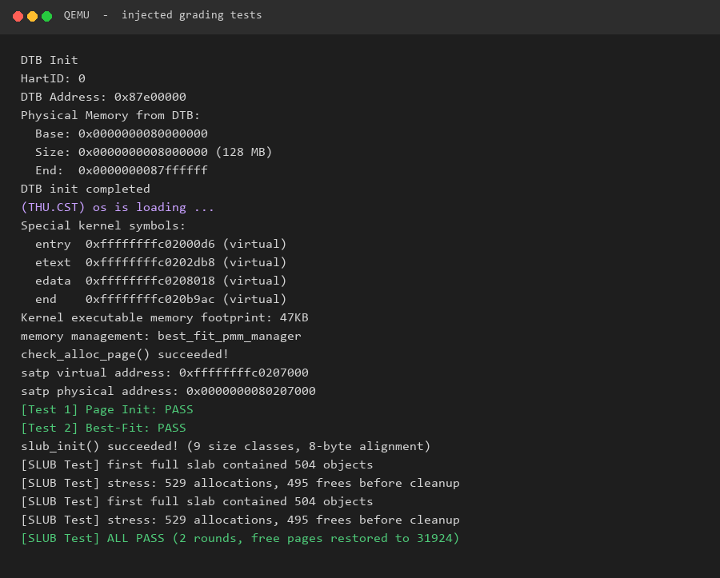

# 操作系统实验报告

## 实验基本信息

| 项目 | 内容 |
|------|------|
| **实验名称** | Lab 2: 物理内存和页表 |
| **小组成员** | 2410550-杨博 2411210-王禹博 2413124-梁昊 |
| **完成日期** | 2026.10.23 |

### 小组分工


| 成员 | 负责的练习/模块 |
|------|----------------|
| 2411210-王禹博 | 模块一：物理内存初始化功能 |
| 2410550-杨博   | 扩展任务Challenge：任意大小的内存单元 slub 分配算法 , 分支任务：gdb调试页表查询过程 |
| 2413124-梁昊   | 模块二：Best-Fit 物理页分配 |

---

## 一、实验目的

<!-- 说明本次实验的主要目标和预期成果 -->

本实验的主要目的是：

1. 理解物理内存探测、页描述符初始化以及虚拟地址与物理地址转换之间的关系，明确哪些页面能够交给内核分配。
2. 实现 Best-Fit 物理页分配，并在其基础上实现简化 SLUB 对象分配，理解从按页管理到按对象管理的两层内存分配方式。
3. 根据现有内核接口设计提示词，借助 AI 生成分配模块和测试，通过数据读写、对象隔离与页面回收检查验证实现。

---

## 二、实验环境

你们使用的 AI 工具

| 成员 | AI 编程工具 | 底层模型 | 备注 |
|------|------------|---------|------|
| 2411210-王禹博 | Codex | GPT-6.1 sol|
| 2410550-杨博 | Codex | GPT-6 | SLUB 分配模块与测试 |
| 2413124-梁昊 | Claude Code（VS Code 扩展） | Claude | |

SLUB 模块的集成验证使用 RISC-V 64 位目标环境，交叉编译器为 `riscv64-unknown-elf-gcc 15.1.0`，QEMU 版本为 `4.1.1`，启动日志显示 OpenSBI 版本为 `0.4`。使用工程默认的 GNU99 编译配置和 `make qemu` 启动方式，QEMU 提供 128 MiB 物理内存。模块二组员所使用的另一套环境及其适配过程保留在对应模块中。


## 三、实验整体逻辑分析

### 2.1 本章节的逻辑主线

本章实验围绕内存管理展开，分为：虚拟内存->物理内存的映射，物理内存探测，物理内存管理。主要讲了页表的设计、实现、为什么要分页，快表，物理内存探测（DTB）、页面分配算法。

解决的问题是，如何让操作系统看到的是虚拟地址，但实际使用时转换为物理地址，从而避免一系列冲突，也有利于内存的分配。

在能够管理物理页之后，还需要考虑更小粒度的内存申请。例如，一个对象只需要几十字节，如果每次都单独分配一页，就会浪费较多空间。因此，SLUB 扩展任务继续复用已有的物理页分配器，在页内划分对象槽，实现从物理内存探测、按页分配到按对象分配的完整流程。

### 2.2 功能的逐步实现

1. 首先通过 DTB 获取物理内存范围，由 `page_init()` 初始化页描述符，排除内核和描述符数组等已占用区域，建立可分配物理页的范围。
2. 接着实现 Best-Fit 页面分配器，维护连续空闲页块，完成页分配、分割、释放和相邻块合并，向上提供 `alloc_pages()`、`free_pages()` 等接口。
3. 然后实现简化 SLUB 分配器。小对象按大小类别共享 slab 页，大对象直接申请连续页；页资源仍统一由 Best-Fit 管理，避免在对象层重复实现物理内存管理。
4. 最后接入 SLUB 测试，检查不同大小对象的实际容量、相互隔离、空槽复用及页面回收，同时运行原有评分测试，确认扩展模块与底层页管理能够共同工作。

---

## 四、实验内容与实现


### 功能模块一：物理内存探测与页描述符初始化

**负责人：** 2411210-王禹博

#### 模块功能描述

本模块负责获取内核可管理的物理内存范围，并初始化物理页描述符。启动时，OpenSBI/启动环境通过启动参数传递设备树（DTB）的地址；入口代码保存该地址，`dtb_init()` 解析 DTB 中的内存信息，供后续内存管理初始化使用。`page_init()` 根据物理内存基址和大小、内核结束位置以及 `struct Page` 描述符数组的占用范围，计算物理页号范围，初始化页描述符，并将未被内核及描述符数组占用的完整物理页交给现有 PMM 接口管理。

**涉及的函数/接口：**

```c
void dtb_init(void);
uint64_t get_memory_base(void);
uint64_t get_memory_size(void);
static void page_init(void);
void pmm_init(void);
```

其中 `dtb_init()`、`get_memory_base()`、`get_memory_size()` 和 `pmm_init()` 由实验框架提供；本模块主要实现 `kern/mm/pmm.c` 中的 `page_init()`，并结合 DTB 接口完成物理内存信息的获取。

#### 最终提示词

以下提示词用于根据当前实验源码实现并审查 `page_init()`。整理后的提示词应在提交前与实际使用记录核对。

```text
我正在完成 riscv64-ucore 操作系统实验 Lab2，负责模块一：物理内存探测与页描述符初始化。请以当前项目源码为准，不要套用其他版本 uCore 的实现。

请阅读 kern/driver/dtb.c、kern/driver/dtb.h、kern/init/entry.S、kern/init/init.c、kern/mm/pmm.c、kern/mm/pmm.h、kern/mm/memlayout.h、kern/mm/mmu.h，以及相关测试代码。

当前 pmm.c 中的 page_init() 需要实现。请遵循项目已有接口和地址布局约定，完成以下工作：
1. 按当前框架设置 va_pa_offset = PHYSICAL_MEMORY_OFFSET。
2. 通过 get_memory_base() 和 get_memory_size() 获取 DTB 解析出的物理内存基址和大小，并检查无效值及地址加法溢出。
3. 遵循 DRAM_BASE、nbase、PPN、PGSIZE 的定义，计算 npage 和 Page 描述符数量。
4. 将 pages 数组放在链接器符号 end 之后，并按页对齐。
5. 初始化相关 struct Page 的 ref、flags、property，并在可用性确认前将页面标记为保留。
6. 计算 Page 描述符数组结束位置对应的物理地址，按页向上对齐，确定可用完整物理页的起点。
7. 不得将内核镜像、Page 描述符数组或其他已占用区域加入空闲页区。
8. 使用现有 PADDR()、pa2page() 和 init_memmap() 接口，不要重写其他组员负责的分配算法。
9. 解释每个关键变量、地址单位、边界条件和当前实现依赖的内存布局假设。
10. 提供代码检查、单文件编译、完整构建和运行验证的步骤，并明确区分这些验证的结论。

如果源码和上述假设不一致，请先指出差异，不要修改框架测试或其他模块。
```

#### 实现迭代过程

##### 第一次迭代：实现 `page_init()`

**实现内容：**

- 在 `kern/mm/pmm.c` 中对应的 `//lab2 function1` 位置编写 `page_init()`。
- 获取 DTB 解析得到的物理内存基址与大小，并加入参数有效性和地址溢出检查。
- 设置地址转换偏移，计算 `npage`，在内核结束符号 `end` 之后按页对齐放置 `pages` 描述符数组。
- 初始化描述符并标记为保留，计算描述符数组之后的空闲页范围，调用 `init_memmap()`。

**验证情况：**

- 已执行 `make obj/kern/mm/pmm.o`，终端显示 `+ cc kern/mm/pmm.c` 且没有出现编译错误；这说明 `pmm.c` 对应的目标文件单独编译通过。
- 执行 `make qemu` 时，完整构建在 `kern/mm/best_fit_pmm.c` 处因 `free_list` 和 `nr_free` 未声明而停止。错误发生在 QEMU 启动之前，目前尚不能据此判断 `page_init()` 的运行时正确性。
- 完整 QEMU 启动、模块一运行测试和 `make grade` 的结果均待补充。

**问题与处理策略：**

1. **完整构建被其他模块阻塞：** 当前 `pmm.c` 选择 `default_pmm_manager`，但构建过程仍会编译 `best_fit_pmm.c`。应由负责 Best-Fit 的组员检查该模块，不能为了绕过错误而修改框架中的 `basic_check()` 或 `best_fit_check()`。
2. **运行时边界尚待验证：** 单文件编译不能验证 DTB 数据、实际内存布局、描述符数组范围以及 `init_memmap()` 的运行行为。完整构建恢复后，需要运行 QEMU 并检查实际日志和测试结果。

**关键注意事项：**

- 区分虚拟地址、物理地址、页号和字节数，地址转换遵循当前框架的 `va_pa_offset` 约定。
- 内核镜像和 `Page` 描述符数组占用的物理页不得被加入空闲页区。
- 当前实现依赖课程框架中的 DRAM 起始地址和映射约定；若运行环境不同，应重新核对这些假设。

以上为模块一首次实现时的验证记录。完成模块二和 SLUB 的集成后，完整构建、QEMU 运行及原有评分测试均已通过，集成验证结果见第五节。

---

### 扩展任务 Challenge：硬件的可用物理内存范围的获取方法

**负责人：** 2411210-王禹博

**题目：** 如果 OS 无法提前知道当前硬件的可用物理内存范围，请问你有什么办法让 OS 获取可用物理内存范围？

**回答：**

操作系统不应简单地假设所有机器都具有相同的物理内存起始地址和容量。比较通用的做法是让启动固件或引导程序在启动时提供物理内存布局信息，内核再解析这些信息，确定哪些物理地址范围属于 RAM、哪些区域被固件或设备保留。

常见方法包括：

1. **通过设备树（DTB）获取内存信息。** 在本实验的 RISC-V uCore 启动流程中，启动环境传入 DTB 地址，内核保存该地址并由 `dtb_init()` 解析设备树中的内存节点，进而通过 `get_memory_base()` 和 `get_memory_size()` 获取物理内存基址与大小。内核随后还需要排除内核镜像、页描述符数组及其他保留区域，才能得到真正可分配的物理页范围。
2. **通过固件提供的内存映射接口获取。** 例如，在支持 UEFI 的平台上，操作系统加载阶段可以从 UEFI Boot Services 获取内存映射；在传统 PC 启动环境中，引导程序也可以查询 BIOS 提供的内存映射信息，并将结果传给内核。操作系统根据映射中的类型和范围识别可用内存及保留区域。
3. **由引导程序探测后传递内存布局。** 如果内核本身不直接解析固件接口，也可以让 bootloader 负责查询平台内存信息，再通过约定的启动参数或数据结构把内存区域列表交给内核。
4. **读取平台相关的硬件寄存器或固件表。** 某些嵌入式平台可以通过 SoC 文档规定的寄存器或固件描述确定 DRAM 范围。但这种方法依赖具体硬件，移植性较差，不适合作为所有平台通用的方案。

不建议操作系统在没有平台支持的情况下，简单地向任意物理地址写入或读取数据来“试探”内存范围：该地址可能对应设备寄存器、固件保留区或不存在的物理空间，探测本身就可能触发异常或产生副作用。

因此，较稳妥的设计是：**由固件或引导程序提供可信的物理内存区域描述，内核解析并校验这些范围，再结合内核自身和其他保留区域的布局，计算最终可供物理内存分配器使用的页面集合。** 本实验采用 DTB 获取内存信息，就是这种设计方式的一个例子。

---

### 功能模块二：Best-Fit 物理页分配

**负责人：** 2413124-梁昊

#### 模块功能描述

**需要实现/修改的函数：**

```c
static void best_fit_init(void);
static void best_fit_init_memmap(struct Page *base, size_t n);
static struct Page *best_fit_alloc_pages(size_t n);
static void best_fit_free_pages(struct Page *base, size_t n);
static size_t best_fit_nr_free_pages(void);

const struct pmm_manager best_fit_pmm_manager;
```

**功能说明：**

本模块实现物理内存管理器 `best_fit_pmm_manager`，向上提供与 `default_pmm_manager` 相同的接口。`pmm.c` 中的 `init_memmap()`、`alloc_pages()`、`free_pages()`、`nr_free_pages()` 不需要改动，只要把 `pmm_manager` 指向本模块即可。

分配采用最佳适配策略：遍历空闲链表，在所有 `property >= n` 的连续空闲块中选择 `property` 最小的那个，从而尽量保留大块内存。若选中的块比请求大，则把剩余部分留在链表里继续作为空闲块。释放时按地址顺序插回链表，并与前后相邻的空闲块合并，避免产生碎片。

模块一与本模块的接口是 `init_memmap(base, n)`：模块一算好可用物理内存区间后，把这段区间交给本模块建立空闲链表，之后内核的所有页分配都经过本模块。

#### 最终提示词

````markdown
[PROMPT]
在 riscv64-ucore 的 lab2 中实现 best_fit_pmm.c。当前文件只有 pmm_manager 所需函数的空位，
同一目录下的 default_pmm.c 已经提供 first-fit 的完整实现，可作为结构参考，但分配策略必须改成最佳适配。

[RELY]
- struct Page 的字段：ref、flags、property、page_link
- PageReserved / PageProperty / SetPageProperty / ClearPageProperty
- list_init / list_add / list_add_before / list_del / list_empty / list_next / list_prev
- le2page、alloc_page、free_page
- free_area_t、free_list、nr_free

[GUARANTEE]
实现并导出：
static void best_fit_init(void);
static void best_fit_init_memmap(struct Page *base, size_t n);
static struct Page *best_fit_alloc_pages(size_t n);
static void best_fit_free_pages(struct Page *base, size_t n);
static size_t best_fit_nr_free_pages(void);
const struct pmm_manager best_fit_pmm_manager;
同时把 pmm.c 中 init_pmm_manager() 的选择改为 &best_fit_pmm_manager。

[SPECIFICATION]
1. init_memmap：把 [base, base+n) 的每页清 ref、清 flags、标记 Reserved；首页 property = n 并置 Property；
   按地址顺序插入 free_list；nr_free += n。
2. alloc_pages(n)：n > nr_free 返回 NULL；遍历整个链表，在所有 property >= n 的块中选择 property 最小者；
   找不到返回 NULL；选中后从链表删除，若 property > n 则把 page+n 开始的剩余块插回并令 property -= n；
   nr_free -= n；返回块首。
3. free_pages(base, n)：检查每页非 Reserved 且非 Property，清 flags、清 ref；base->property = n、
   置 Property、nr_free += n；按地址顺序插回；分别与前一空闲块和后一空闲块合并。
4. 不得修改 basic_check 和 best_fit_check。
````

#### 实现迭代过程

本模块的实现经历了 2 次迭代，过程如下：

---

##### 第一次迭代

先按 `default_pmm.c` 的结构写出五个函数，分配部分沿用了 first-fit 的写法：遍历链表，遇到第一个 `property >= n` 的块就 `break`。

**遇到的问题：**

运行注入测试后 `[Test 2] Best-Fit: FAIL`。`best_fit_check` 在释放 `p0+1` 的两页和 `p0+4` 的一页之后，期望分配 1 页时返回 `p0+4` 这个最小的空闲块，但 first-fit 返回了链表中靠前的大块，导致 `assert(p0 + 4 == p1)` 失败。

**问题解决策略：**

在提示词的 [SPECIFICATION] 中把分配规则明确成“遍历整个链表，在所有足够大的块中选 `property` 最小的一个”，并记录当前最小块大小 `min_size`，而不是遇到第一个合适的块就退出。修改后该断言通过。

---

##### 第二次迭代

**遇到的问题：**

分配已经符合最佳适配，但 `best_fit_check` 末尾的 `assert(total == 0)` 仍会失败。原因是释放时只把页插回链表，没有和相邻空闲块合并，空闲链表里出现本应合并的相邻块，最后按块统计的数量与原始链表对不上。

**问题解决策略：**

在提示词中补充释放流程的两个合并步骤：插回后先看前驱，若 `prev + prev->property == base` 则把当前块并入前驱；再看后继，若 `base + base->property == next` 则把后继并入当前块。同时插入时保持按地址升序，保证相邻块在链表中也相邻。

---

##### 最终结果

经过 2 次迭代，该模块最终：
- 编译通过
- `[Test 1] Page Init: PASS`
- `[Test 2] Best-Fit: PASS`
- `check_alloc_page() succeeded!`

#### 运行环境适配

本机使用 QEMU 11.1 + OpenSBI 1.8.1。Makefile 中的 `make qemu` 用 `-device loader` 启动时，OpenSBI 的 Domain0 Next Address 为 0，内核不会被执行；改用
`qemu-system-riscv64 -machine virt -display none -bios default -kernel bin/ucore.img -serial stdio`
后可以正常启动。

另外，`entry.S` 的启动页表原本只映射了 `0xFFFFFFFFC0000000` 以上的虚拟地址。内核入口实际从物理地址 `0x80200000` 开始执行，执行 `csrw satp` 后，下一条指令的取指仍发生在物理地址 `0x80200038`；该地址没有映射就会触发取指缺页（GDB 里 `scause = 12`）。因此在启动页表中补了一条 `0x80000000 - 0xBFFFFFFF` 的恒等映射，开分页瞬间和之后的高地址映射都能正常执行。该改动不改变页表大小，也不影响 `page_init` 对物理内存的统计。

---

### 练习：[练习标题]

**负责人：** [学号-姓名]

[按照练习的具体要求进行解答]

---

### 扩展任务 Challenge：任意大小的内存单元 SLUB 分配算法

**负责人：** 2410550-杨博

#### 模块功能描述

本模块在已有 Best-Fit 物理页分配器上增加对象分配层。第一层仍以 4096 字节的页为单位管理物理内存，第二层将页划分成可复用的对象槽，满足不同字节数的申请。这样，小对象可以共享一张页；超过小对象阈值的请求则直接使用连续页，保留对较大对象的支持。

实验没有提供 SLUB 的代码框架和测试函数，因此本模块分别设计了实现提示词和测试提示词，先生成分配模块，再生成独立测试。本次实现保留对象缓存、空闲对象链表和整页回收等主要思想，按单核、无并发调用的实验环境简化。

**涉及的文件与接口：**

以下源码路径均相对于 `code/` 目录。

| 文件 | 作用 |
|------|------|
| `kern/mm/slub.h` | 声明对象分配接口、8 字节对齐要求和 2048 字节的小对象阈值 |
| `kern/mm/slub.c` | 实现大小分类、slab 管理、大对象分配和释放 |
| `kern/mm/slub_test.h` | 声明测试入口 |
| `kern/mm/slub_test.c` | 实现数据核验、边界测试和混合压力测试 |
| `kern/init/init.c` | 在 `pmm_init()` 后依次调用 `slub_init()`、`slub_test()` |

```c
void slub_init(void);
void *slub_alloc(size_t size);
void slub_free(void *ptr);
void slub_test(void);
```

其中 `slub_test()` 属于测试模块。分配模块仅依赖现有的页管理和地址转换接口，不修改 `struct Page` 的布局，也不使用其 `flags`、`property` 或 `page_link` 保存对象管理信息。`kern/mm` 已在 Makefile 的源码扫描范围内，因此新增文件能够自动参与编译，无需修改构建规则。

#### 最终提示词

两份提示词均采用 `[PROMPT]`、`[RELY]`、`[GUARANTEE]`、`[SPECIFICATION]` 四段式结构。第一份明确底层可用接口和分配释放约定，第二份以这些约定为独立判据生成测试，完整文本同时保存在 [prompt.md](./prompt.md) 中。

##### 提示词一：从零实现 SLUB 模块并接入内核

```text
[PROMPT]
**任务**：我正在完成 riscv64-ucore 操作系统 Lab2 的 Challenge。实验没有提供 SLUB 的代码框架，请从零新建 code/kern/mm/slub.h、code/kern/mm/slub.c，实现简化 SLUB 内存对象分配器，并修改 code/kern/init/init.c 接入内核。采用两层架构：底层复用现有 Best-Fit 物理页分配器，上层将页面划分成多个可复用的小对象槽；大对象使用连续多页。要求能体现对象缓存、空闲对象链表和页面回收的主体思想，不要求实现 Linux SLUB 的全部功能，也不要求特定时空复杂度。

**操作要求**：必须修改项目中的实际文件，而不是仅展示代码。先阅读 code/kern/mm/pmm.h、pmm.c、memlayout.h、mmu.h、best_fit_pmm.c、code/kern/init/init.c、code/libs/defs.h、list.h、string.h 及 code/Makefile。保留已有物理页管理、检查函数和启动流程；不要修改 struct Page 布局或复用其 flags、property、page_link 保存 SLUB 元数据。仅允许新增上述 slub 文件、在 init.c 添加初始化调用，以及必要时补充 Makefile 的编译配置。现有 kern/mm 已属于源码扫描目录，应先核实现有规则是否已能编译新文件。本提示词只生成分配模块，测试由下一份提示词完成。

**输出要求**：完成实际文件修改后，说明数据结构、大小类别、元数据布局、对象地址与所属 slab 的关联方式、分配释放流程及内核接入点。列出修改文件和实际执行的构建命令及结果；若工具链缺失或构建失败，说明真实原因，不能声称已经通过。以工程真实代码为准，不引入 libc、Linux 内核头文件或工程没有提供的接口。

[RELY]
1. 当前物理页分配接口位于 code/kern/mm/pmm.h：
   struct Page *alloc_pages(size_t n);
   void free_pages(struct Page *base, size_t n);
   size_t nr_free_pages(void);
   #define alloc_page() alloc_pages(1)
   #define free_page(page) free_pages(page, 1)
   static inline uintptr_t page2pa(struct Page *page);
   static inline struct Page *pa2page(uintptr_t pa);
   extern uint64_t va_pa_offset;
   extern struct Page *pages;
   extern size_t npage;
   extern const size_t nbase;
   pmm_init() 已选择 best_fit_pmm_manager，完成页初始化及原有检查。alloc_pages(n) 分配连续 n 页，失败返回 NULL；free_pages 必须接收正确的块首页和原页数，不能传入 0 页。

2. code/kern/mm/mmu.h 中定义：
   #define PGSIZE 4096
   #define PGSHIFT 12
   #define PPN(la) (((uintptr_t)(la)) >> PGSHIFT)

3. code/kern/mm/memlayout.h 中的页描述符为：
   struct Page {
       int ref;
       uint64_t flags;
       unsigned int property;
       list_entry_t page_link;
   };
   页描述符由 PMM 管理，SLUB 元数据应放在已分配页内部或模块静态存储中。释放页之后，不能再访问该页中的元数据。

4. 当前采用固定虚实地址偏移。把 page2pa(page) + va_pa_offset 转换为指针可访问已分配页；PADDR(kva) 可将有效内核虚拟地址转为物理地址。pmm.h 中的 KADDR 宏目前被注释，且没有 page2kva/kva2page，不能直接调用这些接口。

5. code/libs/defs.h 提供 size_t、uintptr_t、uint8_t、NULL、ROUNDUP、ROUNDDOWN；size_t 和 uintptr_t 均为 64 位无符号类型。ROUNDUP 内部包含加法，必须在调用前处理溢出。不要假定存在 SIZE_MAX，可以使用 (size_t)-1 表示最大 size_t。
   code/libs/string.h 提供：
   void *memset(void *s, char c, size_t n);
   void *memcpy(void *dst, const void *src, size_t n);
   还可使用 list.h、assert.h 和 stdio.h 中工程已有的链表、断言及 cprintf。

6. kern_init() 目前在 pmm_init() 后进入永久循环。SLUB 初始化应放在 pmm_init() 返回后。编译环境为 RISC-V 64 位、GNU99、-nostdinc、-nostdlib，并启用 -Wall、-Werror；不能使用宿主 malloc/free 或未提供的运行库。

[GUARANTEE]
在新建的 code/kern/mm/slub.h 中声明，并在 slub.c 中实现：
    void slub_init(void);
    void *slub_alloc(size_t size);
    void slub_free(void *ptr);

在 slub.h 中新增公开常量，供调用者和后续测试使用：
    #define SLUB_ALIGN 8
    #define SLUB_SMALL_MAX 2048

修改已有接口：
    int kern_init(void);
保留其 noreturn 属性及已有逻辑，在 pmm_init() 返回后调用一次 slub_init()。

允许新增模块内部的 static 辅助函数、静态缓存描述符及宏。不要求对外提供 Linux kmalloc/kmem_cache 接口。初始化和元数据管理不得递归调用 slub_alloc 来引导自身。

[SPECIFICATION]
## slub_init
**Pre-Condition**：pmm_init() 已完成，物理页分配器可用；当前实验按单核、无并发调用处理。
**Post-Condition**：所有大小类别和模块内部状态已初始化，后续分配释放可用；采用静态缓存描述符和按需分配 slab 页的方式，初始化不消耗物理页。
  **Case 1**：首次调用时，建立空的缓存管理状态，不预先申请对象页。
  **Case 2**：重复调用时直接返回，不清空已建立的状态、不丢失仍在使用的对象。
**Requirements**：不得改动 PMM 的空闲链表、页计数或已分配页面的所有权。

## slub_alloc
**Pre-Condition**：slub_init() 已执行；size 表示调用者需要的有效负载字节数。
**Post-Condition**：成功返回至少 SLUB_ALIGN 字节对齐的内核虚拟地址，其后至少 size 字节可读写；所有存活对象的有效负载互不重叠，且不覆盖分配器元数据。失败返回 NULL，既有对象和管理状态保持有效，不泄漏已申请的页。不要求将新分配的有效负载清零。
  **Case 1**：size == 0 时返回 NULL，不消耗对象槽或页面。
  **Case 2**：1 <= size <= SLUB_SMALL_MAX 时，使用 8、16、32、64、128、256、512、1024、2048 字节有效负载类别，向上选择可容纳请求的最小类别。同一 slab 页只管理一个类别；优先从已有可分配 slab 的空闲对象链表取得槽位，必要时通过 alloc_pages(1) 新建 slab 页。页头、对象头、链表指针和对齐填充都必须计入布局，不能假定整页均为用户负载。空闲链表可复用空闲对象区域，但对象分配后不得覆盖其有效负载。
  **Case 3**：size > SLUB_SMALL_MAX 时，通过 alloc_pages 分配足够的连续页，并保存块首页和实际页数等释放所需信息。计算必须覆盖元数据、对齐填充和全部有效负载；申请 PGSIZE 字节不保证仅占一页。返回的仍是有效负载地址。
  **Case 4**：大小计算发生加法、乘法或向上取整溢出，或请求明显超过系统可管理内存时，在访问对象内存前返回 NULL。无法获得所需页时也返回 NULL，回滚中途取得的资源。
**Requirements**：区分“类别的有效负载容量”和“对象槽总跨度”。保证每个小对象类别在一页内确实存在可用槽位，可靠管理空闲、部分使用、全满状态；可使用单一 slab 链表加使用计数简化实现。大小类别仅是内部取整策略，调用者可以请求非类别大小。请求能否成功受可用内存和连续页条件限制，不能通过仅支持固定几个入参或设置过小的请求上限代替任意大小分配。

## slub_free
**Pre-Condition**：模块已初始化；ptr 为 NULL，或是本模块返回且尚未释放的对象起始地址。不要求支持非法地址、内部偏移地址或重复释放，须明确这些情况不在接口保证范围内。
**Post-Condition**：释放目标对象，对其他存活对象的数据和可用性无影响；其槽位或底层页可再次分配。不要求保留已释放对象的数据。
  **Case 1**：ptr == NULL 时直接返回，不改变任何资源计数。
  **Case 2**：小对象释放后放回所属 slab 的空闲对象链表，更新使用计数和可分配状态；原来全满的 slab 必须重新能够分配。当该 slab 最后一个存活对象释放后，从管理结构中移除该 slab，并立即把其页归还 PMM，不保留空 slab 页。
  **Case 3**：大对象释放时，根据元数据恢复最初分配的块首页和页数，完整归还连续页。不要仅按 ptr 所在页释放，也不要向调用者要求额外传入大小。
**Requirements**：在归还页之前保存后续所需的信息并移除页内链表节点，归还后不再解引用页内元数据。能够在其他对象仍存活时释放任一对象，不能要求严格按逆序释放。所有对象释放后，nr_free_pages() 应恢复到本轮分配前的值。

## 内核接入与验证
**Pre-Condition**：工程已有模块及其检查逻辑完整保留。
**Post-Condition**：内核启动时在 PMM 可用之后完成 SLUB 初始化，现有物理页检查仍能通过。
**Requirements**：在 code/ 下执行 make 构建，必要时先 make clean；可以运行 make qemu 检查启动，但此阶段不能据此声称 SLUB 功能测试已通过。说明单核简化、大小分类和大对象路径等设计取舍，确保下一份提示词能基于公开接口编写测试。
```

##### 提示词二：为生成的 SLUB 模块设计并接入测试

```text
[PROMPT]
**任务**：针对上一份提示词已经生成的 SLUB 分配模块，独立设计并实现内核内测试函数，验证不同大小对象的分配、写入、释放、重用和页面回收。实验没有提供 SLUB 测试框架，请新建 code/kern/mm/slub_test.h、code/kern/mm/slub_test.c，并修改 code/kern/init/init.c，在 slub_init() 后调用测试入口。

**操作要求**：必须修改实际文件。先阅读 code/kern/mm/slub.h、slub.c、pmm.h、pmm.c、mmu.h、code/kern/init/init.c 和 code/Makefile，再按公开接口及本提示词的行为规格编写测试。测试应独立计算预期结果，以实际读写、对象区间和 PMM 页数验证正确性，不得把分配器内部计算原样复制为测试判据。允许读取源码以了解类别布局和构造状态转换，但不要直接操作模块内部链表、PMM 空闲链表或管理计数。

发现第一份实现不符合约定时，应通过测试暴露问题并说明原因；不得删除测试、放宽断言或改变约定使其通过。本任务仅新增测试文件、添加启动调用及必要的构建配置，不修改现有评分测试和分配算法；若被测实现存在缺陷，应如实报告失败位置和修复建议。

**输出要求**：给出实际修改文件、每组测试的目的与判据，以及“测试行为—可能检出的缺陷—有效性理由”的简要说明，便于写入实验报告。执行实际构建和 QEMU 测试，报告真实日志；不能把预期输出冒充运行结果。若环境阻止执行，明确尚未验证的部分。

[RELY]
1. 第一份提示词要求 slub.h 导出：
   #define SLUB_ALIGN 8
   #define SLUB_SMALL_MAX 2048
   void slub_init(void);
   void *slub_alloc(size_t size);
   void slub_free(void *ptr);
   小对象有效负载类别为 8、16、32、64、128、256、512、1024、2048；超过 2048 字节走连续多页路径。以上是约定接口，执行前必须核对生成的实际代码，发现缺失应明确报告。

2. 约定行为：零大小返回 NULL；成功指针至少 8 字节对齐，负载至少为请求大小；不要求初始内容为零；不同存活对象负载不重叠；释放 NULL 无副作用；不测试非法指针或重复释放。空 slab 立即归还物理页，大对象完整归还其页；slub_init 不申请页且重复调用不丢失对象。

3. 工程提供：
   size_t nr_free_pages(void);
   struct Page *alloc_pages(size_t n);
   void free_pages(struct Page *base, size_t n);
   #define PGSIZE 4096
   size_t、uintptr_t、uint8_t、NULL，以及 assert、cprintf、memset。
   size_t 为 64 位无符号类型，最大值可写为 (size_t)-1。
   返回地址是内核虚拟地址，测试应直接读写该地址，不能把它作为物理地址使用。

4. 当前 Makefile 扫描 kern/mm，新建测试文件放在这里可以复用编译规则。code/tools/test_lab2.c 仅包含已有的页面初始化和 Best-Fit 评分测试，不能假定其中已有 SLUB 测试，也不能假定 make test 会自动调用新增函数。kern_init() 的启动调用才是本次测试的实际入口。
   默认内核栈只有 2 * PGSIZE。较大的指针表、长度表等测试数据使用固定上界的 static 数组，不能放在栈上，也不能使用被测 slub_alloc 分配测试管理结构。环境为 GNU99，无宿主 libc。

[GUARANTEE]
在 code/kern/mm/slub_test.h 中声明，并在 slub_test.c 中实现：
    void slub_test(void);

修改已有接口：
    int kern_init(void);
在已有 slub_init() 后、永久循环前调用一次 slub_test()，保留其他启动逻辑。

各测试组、模式填充、数据核验、区间重叠检查等辅助函数设为 static，自行命名。允许新增测试用静态数组，不增加必须依赖的分配器公开接口。成功组打印明确的 [SLUB Test] ... PASS，全部通过后打印 [SLUB Test] ALL PASS；任何断言失败必须中止成功路径，不得继续打印总通过。

[SPECIFICATION]
## slub_test
**Pre-Condition**：pmm_init 和 slub_init 已完成，单核顺序执行，测试开始时没有其他模块持有 SLUB 对象。运行期间没有其他消费者改变 PMM 空闲页数量。
**Post-Condition**：完成下面各组可重复测试，释放本组申请的全部对象；每组结束及全部结束时，nr_free_pages() 均等于对应的起始快照。测试成功有明确日志，失败时能够定位测试组、请求大小或对象编号。

  **Case 1：初始化与空操作**。
  记录初始页数，检查 slub_alloc(0) == NULL，调用 slub_free(NULL)，验证页数不变。持有一个已写入模式的小对象后再调用 slub_init()，检查其内容仍正确，且后续仍能分配、释放，最终回到初始页数。该测试检验零长度约定、空释放和重复初始化不会破坏状态。

  **Case 2：类别边界、页边界和任意大小**。
  至少覆盖 1、7、8、9、15、16、17、31、32、33、63、64、65、127、128、129、255、256、257、511、512、513、1023、1024、1025、2047、2048、2049、PGSIZE-1、PGSIZE、PGSIZE+1、2*PGSIZE、2*PGSIZE+1，以及非整齐大小 3、37、100、777、3000、6000。每次成功后验证非 NULL 和对齐，对全部请求字节写入并读回，包括首字节、尾字节和跨页部分，再释放。分组记录并核对空闲页恢复，不能硬编码“大对象一定只占 ceil(size / PGSIZE) 页”，因为元数据和对齐也会占空间。该测试检验向上选择类别、临界值分支和实际容量是否正确。

  **Case 3：多个存活对象互不干扰**。
  同时保留多个同类和不同类对象，包含小对象与多页大对象。先检查每对有效负载区间 [ptr, ptr+size) 不相交，再以“对象编号和字节偏移”确定不同的非零数据模式，写满所有对象后逐一核验。以非分配顺序释放一部分对象，每次释放或后续重新分配后再次核验所有仍存活对象；新对象也写满并参与重叠检查。最后释放全部对象。不能只检查指针互不相等，也不能给所有对象填相同模式。该测试用于检出槽跨度错误、元数据侵入负载、对象别名和释放误伤其他对象。

  **Case 4：跨 slab 扩容、空槽复用与整页回收**。
  使用 size=8 的同类小对象，分配足够数量确保该类别需要至少两张 slab 页，可使用 PGSIZE / SLUB_ALIGN + 1 个对象及固定大小静态指针表；检查实际页面消耗，确保扩容路径确实执行。对对象写入不同模式后，释放其中一部分，保证相关 slab 仍有存活对象；重新申请同类对象并检查未释放对象内容及新旧存活区间。
  构造至少一个“全满 slab 释放一个槽后重新分配”的状态，可结合实际 slab 布局或按页对齐地址分组确认该状态。只要仍有适用空槽，重新分配不得消耗新的物理页；不要求分配器返回某个固定历史地址。逐步清空所有 slab，最终空闲页应精确恢复。该测试检验 full/partial 状态转换、空闲链表复用、扩容和最后一个对象释放时的整页归还。

  **Case 5：大对象分配和乱序释放**。
  同时申请如 2049、4096、4097、8193、16391 字节对象，逐字节检查不同数据模式；将新建的相应静态记录保留至释放结束。乱序释放后核验其余对象，最终检查页数恢复。允许记录每次分配的页数差并在释放时核对相应归还量，不依赖具体元数据头大小。该测试检验大对象容量、跨页写入、原始块首页及页数恢复。

  **Case 6：整数溢出与资源不足失败**。
  同时保留已写入模式的小对象和大对象。测试 (size_t)-1、(size_t)-1-7、(size_t)-1-PGSIZE 等无法满足的请求，必须返回 NULL，且每次调用前后的页数及存活对象内容均不改变。
  另外构造不会触发整数溢出、但显然超出当前空闲页总量的大对象请求，例如在验证乘加运算安全后请求 (nr_free_pages()+1)*PGSIZE 字节；它必须返回 NULL。该普通资源不足测试与极大整数测试分开执行，不能只靠溢出分支替代内存不足验证。失败后再申请和释放正常大小对象，确认分配器仍可用；最终清理全部存活对象并检查基线恢复。该测试检验大小运算、防止小块误分配、失败无泄漏及失败后的状态完整性；不要求耗尽机器全部物理内存。

  **Case 7：重复混合分配与释放**。
  以固定种子或固定序列执行至少数百次有界操作，在固定上限的静态槽表中交错分配、检查、释放不同大小对象。空槽才可分配，存活槽才可释放；每次释放前及周期检查时验证数据模式，新增对象后检查区间不重叠。结束时清空全部槽，并核对页数恢复。完整测试入口连续运行两轮，保证每轮均通过且无累计泄漏。该测试检验多次复用后链表、计数及不同类别的状态是否持续正确。

**Requirements**：
- 断言应针对明确的接口约定，不能假定释放后数据仍保留、分配结果自动清零或固定的地址返回顺序。不得读写超过请求大小的区域，不对已释放对象解引用；释放前若需要页地址等信息必须先保存。
- 分配器不保证非法指针和重复释放的处理，因此不得用会使整套测试提前 panic 的未定义调用充当正常边界测试。
- 正常测试使用有限内存，必要的分配若失败应给出明确诊断，不能静默跳过该组并打印 PASS。以 nr_free_pages() 检查回收时，应确保该组不留下任何存活对象且没有其他分配干扰。
- 在 code/ 下执行 make clean、make，再运行 make qemu 观察串口输出。启动末尾本来就会永久循环，采用合理超时结束 QEMU 时，应结合 ALL PASS 和有无 panic 判断结果，不能仅因超时就判失败或判通过。
- 另外运行现有 make grade，确认原有页面初始化和 Best-Fit 测试不受影响；把原有测试结果与新增 SLUB 测试结果分别说明，不能相互替代。
- 简要解释覆盖的核心行为和边界情况及其检错理由，并说明这些测试可有效发现所列缺陷，但不能形式化证明所有执行路径都正确。
```

#### 实现思路

##### 1. 按大小类别管理小对象

`slub_init()` 建立九个静态缓存类别：`8、16、32、64、128、256、512、1024、2048` 字节。初始化只建立链表和类别信息，不预先申请页面；重复调用时直接返回，避免清空已有对象的状态。

当 `1 <= size <= 2048` 时，选择能够容纳请求的最小类别。例如申请 37 字节时使用 64 字节类别。类别大小是内部取整策略，调用者不需要按类别大小申请。

每个 `slub_cache` 保存对象大小和所属 slab 链表，一张 slab 页只管理一个类别。页内布局如下：

```text
一张 4096 字节的 slab 页
┌──────────────────┬────────┬────────┬─────┐
│ 64 字节管理头    │ 对象槽 │ 对象槽 │ ……  │
└──────────────────┴────────┴────────┴─────┘
```

在本次 RV64 布局中，`slub_page` 管理头占 64 字节，保存原始页描述符、所属类别、分配页数、已使用对象数、槽位容量、空闲对象链表和 slab 链表节点。对象槽从管理头之后开始，每个槽的跨度等于所属类别大小，均满足 8 字节对齐。容量按剩余空间计算：

```text
每页对象数 = (4096 - 64) / 类别大小，取整数部分
```

因此，8 字节类别每页能够存放 504 个对象，64 字节类别每页能够存放 63 个对象。管理头始终位于对象负载之外，不能把整页都当作可写的用户数据区。

##### 2. 使用空闲对象链表完成分配与复用

空闲对象槽的前几个字节用于保存下一个空闲槽的地址，将槽位串成单向链表。对象分配后，这部分空间归调用者使用，分配器不再依赖其中原有的链表指针。

分配时先遍历对应类别的 slab 链表，找到 `freelist` 非空的页，从链表头取出一个槽，并增加 `inuse`。如果已有 slab 都没有空闲槽，就通过 `alloc_pages(1)` 申请新页，建立管理头并初始化所有空闲槽。全满和部分使用的 slab 保存在同一条链表中，通过空闲链表与使用计数区分状态，简化管理过程。

释放时，将对象地址按页向下对齐，定位页首管理头，再把槽位接回空闲链表并减少 `inuse`。全满 slab 释放一个对象后即可重新分配；当最后一个存活对象被释放时，先移除该 slab 的链表节点，再把物理页归还 PMM。归还之后不再访问页内管理头，避免访问已经失去所有权的内存。

##### 3. 大对象直接申请连续页

当 `size > 2048` 时，直接调用 `alloc_pages()`。申请页数必须同时容纳管理头和全部有效负载，计算方式为：

```text
total = size + 管理头大小
页数 = total / PGSIZE + (total % PGSIZE != 0)
```

例如，申请 4096 字节需要两页，因为一页无法同时容纳 64 字节管理头和 4096 字节负载；申请 2049 字节则仍可放在一页中。因此，“大对象路径”表示不再使用类别槽位，不意味着每个请求都一定占用多页。

大对象管理头中的 `cache` 设为 `NULL`，并保存最初的块首页和实际页数。返回指针位于首页管理头之后，因此释放时仍可按页向下对齐找到管理头，再完整归还原连续页块，无需调用者再次提供大小。

##### 4. 边界处理与简化范围

`slub_alloc(0)` 返回 `NULL`，`slub_free(NULL)` 不改变状态。大对象大小在加上管理头之前先检查溢出，页数通过除法和余数计算，避免向上取整时再次发生加法溢出。请求超过可管理页数、当前空闲页数或无法获得连续页时返回 `NULL`，不改变已有对象。

本实现不保留空 slab 页，以便直接通过空闲页数验证完整回收。它没有实现每 CPU 缓存、并发同步或对象构造函数；非法指针、内部偏移指针和重复释放不在接口保证范围内。大小分类会产生一定的内部碎片，连续大对象也可能因物理页碎片而申请失败。上层查找可用 slab 需要遍历该类别的链表，实验以功能正确为主要目标。

#### 实现迭代过程

本模块按两个阶段完成：第一阶段实现分配模块并接入内核，第二阶段生成测试并进行集成验证。两阶段分别使用上述两份提示词，没有通过修改原有评分测试或放宽断言来获得通过结果。

##### 第一阶段：实现分配模块

**实现内容：** 新建 `slub.h`、`slub.c`，完成九种小对象类别、页内管理头、空闲槽链表及大对象路径，并在 `pmm_init()` 返回后调用 `slub_init()`。

**验证情况：** `make` 和 `make clean && make` 均通过；运行 QEMU 后，原有页分配检查通过，并输出 `slub_init() succeeded!`。这一阶段确认了编译和初始化接入，尚不能据此判断对象分配释放的正确性。

##### 第二阶段：实现测试并完成集成验证

**实现内容：** 新建 `slub_test.h`、`slub_test.c`，在初始化后调用测试入口，以实际数据和资源状态检查分配器。测试记录放入固定上限的静态数组，避免占用 8 KiB 内核栈，也避免通过被测分配器申请测试管理结构。

**验证情况：** 新增七组测试连续通过两轮，每轮执行 1024 次混合操作，全部结束后空闲页数恢复到 31925。随后运行 `make grade`，原有页面初始化和 Best-Fit 检查均通过，总分为 `20/20`。详细运行结果见第五节。

#### 测试设计与有效性分析

测试使用三个相互补充的判据：对完整请求范围逐字节读写，检查不同存活对象的地址区间不重叠，以及检查全部释放后物理页数精确恢复。数据模式同时取决于对象编号和字节偏移，避免所有对象填入相同内容时掩盖相互覆盖的问题。

| 测试组 | 核心行为与边界情况 | 判据及能够发现的问题 |
|--------|--------------------|----------------------|
| 初始化与空操作 | 零大小、释放 `NULL`、持有对象时重复初始化 | 空操作不改变页数，重复初始化不破坏已有数据且仍可继续分配释放，可发现管理状态被意外清空 |
| 大小边界 | 39 种大小，包括类别边界两侧、页边界和 37、777、3000 等非整齐大小 | 指针非空且对齐，完整请求范围读写正确，每次释放后页数恢复，可发现类别选择和容量计算错误 |
| 对象隔离与乱序释放 | 同类、不同类及大小对象同时存活，释放部分对象后重新申请 | 检查半开区间 `[ptr, ptr + size)` 不重叠，并在每次释放、重新申请后核验存活对象，可发现槽位重叠和释放误伤 |
| slab 扩容、复用与回收 | 申请 513 个 8 字节对象，构造全满、部分释放和最后一个对象释放 | 实际消耗至少两页；释放槽后重新申请不增加页消耗；最后一个对象释放前保留页、释放后归还页，可发现空闲链表、状态转换和整页回收错误 |
| 大对象 | 同时申请 2049、4096、4097、8193、16391 字节，跨页写入并乱序释放 | 每个对象内容正确，按实际分配时的页数差核对释放量，不硬编码管理头大小，可发现大对象容量不足或释放页数错误 |
| 溢出、资源不足与恢复 | 极大整数请求，以及不会溢出但超过当前空闲页总量的请求 | 失败返回 `NULL`，页数和已有数据不变，后续正常申请仍成功，可发现整数回绕、失败泄漏或状态损坏 |
| 确定性混合压力 | 固定种子，在 64 个静态记录槽中交错执行 1024 次操作，整套测试运行两轮 | 分配时检查重叠、释放前核验数据、运行中定期核验全部对象，最终恢复基线，可发现重复复用后的链表错误和累计泄漏 |

其中，slab 状态转换测试不直接读取分配器内部结构，而是按返回地址所属页分组。保留第一张已经装满的 slab，释放其他页上的对象后，再申请一个对象，确认它必须使用新页；归还该探测对象后，释放第一张页中的一个槽，再次申请必须复用已有页。清理时保留一个对象到最后，确认只有最后一次释放才归还整张页。这样能够验证状态转换路径确实被执行，而不是仅检查“释放后还能申请”。

对于分配失败，测试同时保留一个小对象和一个多页对象，分别检查溢出请求与普通资源不足请求，失败后再次核验原有数据并申请正常对象。普通资源不足测试使用超过当前空闲页总量的请求，不需要耗尽机器全部物理内存；它与极大整数测试分别执行，避免只覆盖溢出分支。

这些测试能够检出上述核心行为和边界处理中的常见错误，但不构成所有执行路径的形式化证明，也未验证并发场景或未定义的释放操作。

---

## 五、测试与验证

<!-- 根据该实验的具体情况，提供完整的测试运行截图，应包含：
- 编译及运行成功的输出（make qemu），可能有多个
- 测试通过的结果（make grade），只有一个
-->

### 编译与运行（模块二阶段）

以下保留模块二组员在其环境中的编译和运行记录，SLUB 接入后的集成验证另列于后。

```bash
make GCCPREFIX=riscv-none-elf- DEFS="-march=rv64gc -mabi=lp64d"
qemu-system-riscv64 -machine virt -display none -bios default -kernel bin/ucore.img -serial stdio
```

内核串口输出：

```text
DTB Init
HartID: 0
DTB Address: 0x87e00000
Physical Memory from DTB:
  Base: 0x0000000080000000
  Size: 0x0000000008000000 (128 MB)
  End:  0x0000000087ffffff
DTB init completed
(THU.CST) os is loading ...
Special kernel symbols:
  entry  0xffffffffc02000d6 (virtual)
  etext  0xffffffffc02018a8 (virtual)
  edata  0xffffffffc0206018 (virtual)
  end    0xffffffffc0206078 (virtual)
Kernel executable memory footprint: 24KB
memory management: best_fit_pmm_manager
check_alloc_page() succeeded!
satp virtual address: 0xffffffffc0205000
satp physical address: 0x0000000080205000
```

按 `tools/inject.py` 注入评测代码后，两个检查项均通过：

```text
[Test 1] Page Init: PASS
[Test 2] Best-Fit: PASS
```

**测试截图：**

 

### SLUB 接入后的集成验证

在第二节记录的 SLUB 验证环境中，从仓库根目录进入 `code/` 后执行：

```bash
cd code
make clean
make
timeout 20s make qemu
```

完整构建成功，编译输出包含 `kern/mm/slub.c` 和 `kern/mm/slub_test.c`。QEMU 串口中的相关实际输出如下：

```text
memory management: best_fit_pmm_manager
check_alloc_page() succeeded!
slub_init() succeeded! (9 size classes, 8-byte alignment)
[SLUB Test] round 1 initialization and empty operations PASS
[SLUB Test] round 1 size boundaries (39 sizes) PASS
[SLUB Test] round 1 live object isolation and unordered frees PASS
[SLUB Test] first full slab contained 504 objects
[SLUB Test] round 1 slab expansion, full/partial reuse and reclaim PASS
[SLUB Test] round 1 large objects and complete page return PASS
[SLUB Test] round 1 overflow, resource shortage and recovery PASS
[SLUB Test] stress: 529 allocations, 495 frees before cleanup
[SLUB Test] round 1 deterministic mixed stress (1024 operations) PASS
[SLUB Test] round 2 initialization and empty operations PASS
[SLUB Test] round 2 size boundaries (39 sizes) PASS
[SLUB Test] round 2 live object isolation and unordered frees PASS
[SLUB Test] first full slab contained 504 objects
[SLUB Test] round 2 slab expansion, full/partial reuse and reclaim PASS
[SLUB Test] round 2 large objects and complete page return PASS
[SLUB Test] round 2 overflow, resource shortage and recovery PASS
[SLUB Test] stress: 529 allocations, 495 frees before cleanup
[SLUB Test] round 2 deterministic mixed stress (1024 operations) PASS
[SLUB Test] ALL PASS (2 rounds, free pages restored to 31925)
```

每轮压力测试中的 529 次分配和 495 次释放合计 1024 次操作，其余 34 个存活对象在收尾阶段全部释放。七组测试均通过，第一张 8 字节对象 slab 实际容纳 504 个对象，与页内布局的容量一致。两轮结束后空闲页数均恢复至测试前的 31925，未见 panic 或测试失败输出。该页数是当前内核镜像和静态测试数据布局下的结果，不是测试代码硬编码的预期常量。

内核在测试结束后进入原有永久循环，因此 `timeout` 最终以退出码 124 结束 QEMU。测试通过的依据是全部检查执行完成并输出 `ALL PASS`，不能仅根据超时退出判断通过或失败。

随后执行原有评分命令：

```bash
make grade
```

实际结果为：

```text
  -check page init:                          OK
  -check best fit:                           OK
Total Score: 20/20
```

新增 SLUB 测试验证对象分配层；原有评分测试验证页面初始化与 Best-Fit，它们的结论分别记录。评分过程会清理当前构建产物，结束后再次执行 `make`，已重新生成可直接运行的内核镜像。

---

## 六、实验总结与收获

### 对操作系统的理解

1. **页管理与对象管理具有不同的分工。** Best-Fit 负责连续物理页的分配和合并，SLUB 在已经取得的页内管理小对象。两层通过页分配接口衔接，既复用已有逻辑，也避免每个小对象都单独占用一页。
2. **对齐、管理信息和有效负载必须分别计算。** 调用者申请的是可读写的数据空间，页头不能包含在承诺给调用者的容量中。申请 4096 字节实际可能需要两页，就是管理开销影响空间布局的具体体现。
3. **碎片问题需要在不同层次理解。** 大小分类会使 37 字节请求占用 64 字节槽位，形成内部碎片；底层即使空闲页总量足够，也可能因缺少连续页而无法满足大对象申请。SLUB 的槽位复用与 Best-Fit 的相邻块合并分别处理不同层面的空间利用问题。
4. **资源所有权需要完整闭合。** 对象释放后应能够复用，空 slab 和大对象释放后应归还页管理器，归还页后不能继续读取页内元数据。测试中精确比较空闲页数，可以把这类资源管理要求转化成可检查的结果。

本次 SLUB 扩展没有涉及多核并发下的同步、每 CPU 缓存，以及虚拟内存中的缺页处理、换入换出等机制。这些仍是完整操作系统内存管理的重要内容，不能由当前测试通过推断其已经实现。

### AI 协作开发的经验

本次 SLUB 开发先分析工程接口，再分别编写实现提示词和测试提示词。提示词需要明确哪些代码可以复用、哪些底层结构不能修改，以及零大小、溢出、失败和回收等情况的行为。例如，当前工程没有可直接调用的 `page2kva()`，需要按真实的地址映射约定取得内核虚拟地址；如果只描述算法名称，生成代码就可能依赖其他版本内核的接口。

测试提示词应给出独立的正确性判据。这里没有照抄分配器的管理头布局去推导所有预期结果，而是从完整负载读写、存活区间不重叠和空闲页数恢复三个方面检查。通过构造全满 slab 后释放空槽等特定状态，还可以确认关键路径确实被执行。

此外，需要区分编译、启动和功能验证的结论。第一阶段能够编译并打印初始化成功，只说明模块已经接入；第二阶段完成对象操作、状态转换及资源回收测试后，才有依据说明所覆盖的分配释放行为正确。原有评分通过说明底层检查未受影响，不能代替新增 SLUB 功能测试。

---

